## Natural Language Processing
### NLP

- Si las computadoras solo pueden procesar datos binarios (0 y 1), ¿cómo hacemos que puedan representar y procesar el lenguaje humano?
- El lenguaje natural es la principal forma de comunicarnos entre los seres humanos.

> Área de las ciencias computacionales que desarrolla métodos para analizar, modelar y entender el lenguaje humano. [@vajjala2020practical]


# Tareas de NLP {background-color="#fdede8"}

## Tareas comunes

| Tarea | Pregunta que responde | Ejemplo en políticas públicas |
|---|---|---|
| Clasificación | ¿A qué categoría pertenece el texto? | Asignar quejas a un área de servicio |
| NER | ¿Qué entidades aparecen? | Extraer personas, organizaciones y lugares de expedientes |
| Sentimiento | ¿Qué tono tiene el texto? | Medir opinión ciudadana en respuestas abiertas |
| Tópicos | ¿De qué temas trata la colección? | Explorar solicitudes de transparencia |
| Búsqueda semántica | ¿Qué textos son parecidos a este? | Encontrar solicitudes similares a una nueva |


## Reconocimiento de entidades (NER)

- Identificar y clasificar fragmentos de texto que representan entidades del mundo real: PERSON, ORGANIZATION, LOCATION, DATE, MONEY.

```
“El juez Julián Pérez dictó sentencia en la Ciudad de México”
→ Julián Pérez: PERSON
→ Ciudad de México: LOCATION
```

- Se usa para análisis de actores, redes de personas y organizaciones, deduplicación y búsquedas avanzadas.

## Análisis de sentimiento

- Asignar una polaridad al texto: positivo, neutral o negativo.

| Texto | Sentimiento |
|---|---|
| "El trámite fue rápido y el personal muy amable" | Positivo |
| "Llevo tres meses esperando una respuesta" | Negativo |
| "Entregué los documentos el martes" | Neutral |

- Es una clasificación multiclase: se entrena igual que cualquier otro clasificador.

## Modelado de tópicos

- Métodos no supervisados que descubren **temas latentes** en un corpus.
- Cada tópico es un conjunto de palabras con alta probabilidad conjunta:
    - Tópico 1: `police, suspect, arrest, investigation`
    - Tópico 2: `container, terminal, yard, vessel`

::: {.callout-warning}
- Supone modelo *bag of words* (ignora el orden).
- El número de tópicos se fija de antemano.
- Un tópico es una construcción estadística, no una etiqueta verdadera.
- Es sensible al preprocesamiento.
:::

# Preprocesamiento de texto {background-color="#fdede8"}

## Limpieza
### Quita ruido y errores evidentes del texto

Elimina cosas que claramente no aportan significado lingüístico útil para etapas posteriores.

- Eliminar caracteres raros
- Quitar emojis (si así se requiere)
- Quitar duplicados de espacios
- Quitar saltos de línea innecesarios
- Eliminar registros vacíos o corruptos
- Corregir codificación (UTF-8, acentos rotos)


## Normalización de texto

Reduce **variaciones superficiales** del texto sin alterar su significado esencial.

- Pasar a minúsculas
- Quitar signos de puntuación
- Normalizar acentos, números o variantes de palabras
- Ejemplo: `"Árboles, niños y fútbol"` → `"arboles ninos y futbol"`

::: {.callout-warning}
- Normalizar puede borrar información relevante (por ejemplo, el acento que distingue *sí* de *si*).
:::


## Preprocesamiento

- El preprocesamiento **transforma texto crudo** en una representación más manejable para análisis computacional.
- No existe un preprocesamiento "correcto" universal: depende del idioma, del dominio y del objetivo analítico.
- Permite decidir qué es señal y qué es ruido en el texto.


## Tokenización

- Proceso de dividir el texto en unidades más pequeñas llamadas *tokens*.
- Define **qué es una unidad de análisis**.
- Tokens pueden ser palabras, subpalabras, caracteres u oraciones.

- ¿Cuáles son los tokens en la siguiente oración?
    - Ayer pagué \$12,543.25 por una televisión, me pareció barata. Hoy voy a estrenarla viendo el béisbol.


## Stopwords

Son palabras muy frecuentes que, en muchos contextos, aportan poco contenido por sí mismas.

- Ejemplos en español: artículos (*el, la*), preposiciones (*de, con*), pronombres (*él, nosotros*)
- Si no se controlan, dominan las frecuencias y pueden sesgar los modelos
- Conviene decidir caso por caso: en análisis de estilo o en modelos de lenguaje modernos, muchas veces se conservan.
- La lista completa en español está disponible en `nltk.corpus.stopwords.words('spanish')`.


## Lematización vs. *stemming*

Dos formas de reducir palabras a una base común:

| Palabra | *Stemming* (raíz cortada) | Lematización (forma de diccionario) |
|---|---|---|
| llegóoo / llegó | lleg | llegar |
| camiones | camion | camión |
| niños | niñ | niño |

- *Stemming* es rápido pero produce raíces que no son palabras.
- La lematización necesita un diccionario o un modelo lingüístico, pero da formas legibles.


## Preprocesamiento
### Ejemplo

| Etapa              | Resultado                                      |
|--------------------|-----------------------------------------------|
| Original           | `"¡¡¡El camión llegóoo a las 10:30pm!!! 🚛🚛"` |
| Limpieza           | `"El camión llegóoo a las 10:30pm"`            |
| Normalización      | `"el camion llego a las 10 30 pm"`             |
| Preprocesamiento   | `["camion", "llegar", "10", "30", "pm"]`       |

- Una vez preprocesado el texto, el siguiente paso es la exploración: tamaño del corpus, longitud de los textos, tamaño y frecuencia del vocabulario (c04).

# Representación del texto {background-color="#fdede8"}

- ¿Cómo puede la computadora leer el lenguaje?
    - *Bag of Words* (BoW)
    - TF-IDF
    - Similitud del coseno

## Bags of Words (BoW)

- Representa un texto como una colección de palabras, sin considerar el orden.

### Ejemplo

- Original
```
documents = ["Perro muerde persona.", # D1
             "Persona muerde perro.", # D2
             "Perro come carne.",     # D3
             "Persona come comida."]  # D4
```

- Vocabulario

```
{'carne': 0, 'come': 1, 'comida': 2, 'muerde': 3, 'perro': 4, 'persona': 5}
```

## Bags of Words (BoW)

### Ejemplo

| Doc | Texto preprocesado    | carne | come | comida | muerde | perro | persona |
| --- | --------------------- | ----- | ---- | ------ | ------ | ----- | ------- |
| D1  | perro muerde persona  | 0     | 0    | 0      | 1      | 1     | 1       |
| D2  | persona muerde perro  | 0     | 0    | 0      | 1      | 1     | 1       |
| D3  | perro come carne      | 1     | 1    | 0      | 0      | 1     | 0       |
| D4  | persona come comida   | 0     | 1    | 1      | 0      | 0     | 1       |

- D1 y D2 tienen el mismo vector: BoW ignora el orden de las palabras.

## TF-IDF
###  Term Frequency–Inverse Document Frequency


:::: {.columns}
::: {.column style="width:100%; font-size: 0.8em;"}

- Expresa cuán relevante es una palabra para una colección de documentos, a partir de su frecuencia en el documento y de su rareza en la colección.
    - Las palabras muy comunes suelen tener un peso bajo o incluso de 0.
    - Las palabras más raras o distintivas tienen un peso más alto, ya que ayudan mejor a diferenciar los documentos.

| Documento               | afuera | carne | come | duerme | gato | juega | mucho | perro | pescado |
| ----------------------- | :----: | :---: | :--: | :----: | :--: | :---: | :---: | :---: | :-----: |
| "El gato come pescado"  |   0    |   0   | 0.53 |   0    | 0.53 |   0   |   0   |   0   |   0.67  |
| "El perro come carne"   |   0    | 0.67  | 0.53 |   0    |  0   |   0   |   0   | 0.53  |   0     |
| "El gato duerme mucho"  |   0    |   0   |  0   |  0.62  | 0.49 |   0   | 0.62  |   0   |   0     |
| "El perro juega afuera" | 0.62   |   0   |  0   |   0    |  0   | 0.62  |   0   | 0.49  |   0     |

:::{.notes}
Valores calculados con `TfidfVectorizer` de scikit-learn (stopword "el" eliminada, normalización L2 por documento). Los valores salen de la fórmula, no son redondeos arbitrarios.
:::

:::
::::

## TF-IDF
### Idea

- Si una palabra aparece varias veces en un documento pero no es frecuente en la colección, es muy importante para ese documento.
    - La importancia de la palabra crece con su frecuencia en el documento.
    - Pero si la palabra es frecuente en toda la colección, reduce su relevancia.

### Características

- Cada dimensión es una palabra del vocabulario
- No entiende significado, solo **frecuencia y rareza**

## Similitud del coseno

- La manera más común de comparar qué tan parecidos son dos vectores de texto.
- Es el coseno del ángulo entre ambos vectores.
- Con TF-IDF normalizado, el coseno no depende de la longitud del documento.

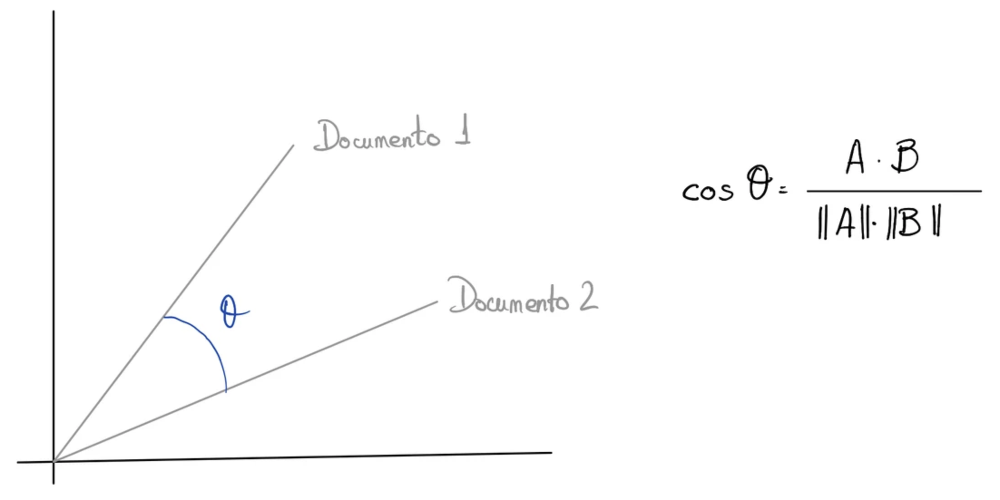

## Similitud del coseno
### Mide el ángulo entre dos vectores

$$\cos(\theta) = \frac{\mathbf{a} \cdot \mathbf{b}}{\|\mathbf{a}\| \|\mathbf{b}\|} = \frac{\sum_{i=1}^{n} a_i b_i}{\sqrt{\sum_{i=1}^{n} a_i^2} \cdot \sqrt{\sum_{i=1}^{n} b_i^2}}$$

- **1**: vectores idénticos (muy similares)
- **0**: vectores ortogonales (sin relación)
- **-1**: vectores opuestos

# Embeddings {background-color="#fdede8"}

¿Cómo describirían la palabra **Olímpicos** con solo números?

- Problema de medición

---

### Medición de características

- Score: 38/100 

::: {.columns}

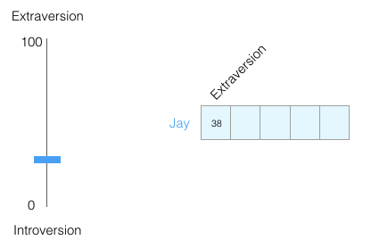

<small>

Tomado de @alammar2019illustrated

</small>

:::

---

### Medición de características

- Lo ponemos en un rango de -1 a 1

::: {.columns}

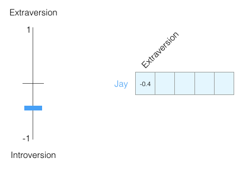

:::

---

### Medición de características

- Agregamos información (otra dimensión)
- Representamos los scores como un vector desde el origen a ese punto de coincidencia

::: {.columns}

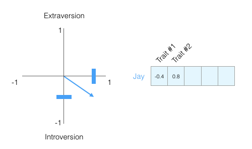


:::

---

### Medición de características

- Puedo agregar información de otras personas

::: {.columns}

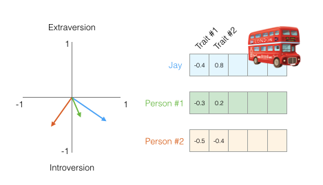

:::

---

### Medición de características

- Quiero buscar alguien similar a Jay 

::: {.columns}

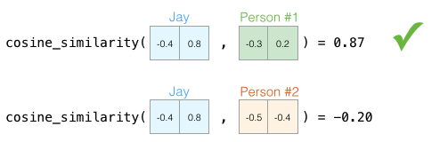

<small>

Tomado de @alammar2019illustrated

</small>


:::

---

### Medición de características

- Pero necesito más información 

::: {.columns}

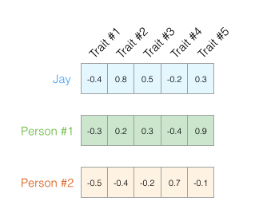

:::

---

### Medición de características

- Ya no es tan sencillo ver las flechas en dos dimensiones. 
- En ML trabajamos con espacios de muchas dimensiones 
	- pero podemos seguir viendo que tanto se parecen los vectores entre sí

::: {.columns}

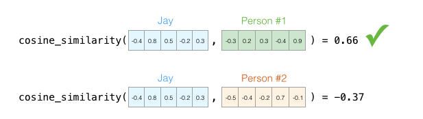

:::


---

### Medición de características

- Podemos representar cosas (palabras) como vectores
- Podemos ver qué tan similares son los vectores entre ellos. 

::: {.columns}

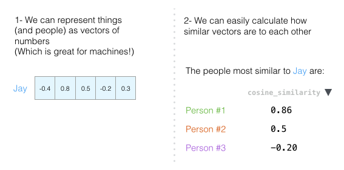

:::


---

### Embedding

Representación vectorial de una palabra, frase o documento.

::: {.columns}

- Es decir, la palabra la podemos representar con diferentes dimensiones, por ejemplo, la palabra **king** con: 


```
[ 0.50451 , 0.68607 , -0.59517 , -0.022801, ..., -2.223 , -1.0756 , -1.0783 , -0.34354 , 0.33505 , ... , -0.25663 , -0.8523 , 0.1661 , 0.40102 , 1.1685 , -1.0137 , -0.21585 , -0.15155 , 0.78321 , -0.91241 , -1.6106 , -0.64426 , -0.51042 ]
```

- Si lo graficamos:


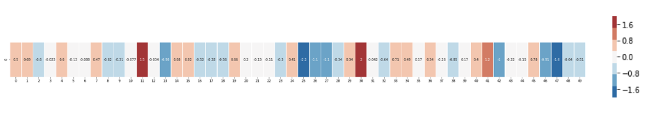

<small>

Tomado de @alammar2019illustrated

</small>


:::


:::{.notes}

Una matriz densa es una matriz donde la mayoría o casi todos sus elementos tienen valores distintos de cero.

:::

---

### Embeddings

- Comparemos ahora **king** con otras palabras 
- ¿Qué observas?

::: {.columns}

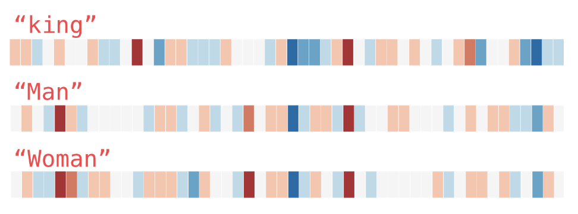

:::

---

### Embeddings

- Estas representaciones vectoriales capturan un poco de información/significado/asociación de estas palabras 

::: {.columns}

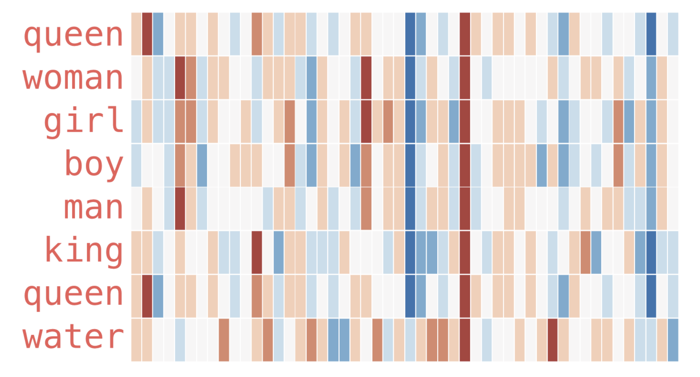

:::


---

### Embeddings

- Si hacemos operaciones con los vectores, las relaciones entre palabras se conservan en parte:

::: {.columns}

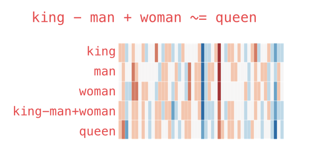

:::

## Word embeddings

- **Vectores densos** que representan palabras, frases o documentos.
- Capturan **similitud semántica** en un espacio de muchas dimensiones.
- Palabras con significados similares → vectores cercanos.
- Típicamente de 100 a 768 dimensiones, según el modelo.

::: {.callout-note}
**Vector Space Model (VSM)**: modelo que representa unidades de texto como vectores.
:::

## Embeddings estáticos (clásicos)

Un vector fijo por palabra:

- **Word2Vec** (2013): Skip-gram y CBOW, desarrollado por Google.
- **GloVe** (2014): basado en co-ocurrencias globales.
- **FastText** (2017): considera sub-palabras.

::: {.callout-warning}
"Banco" tiene un solo vector, aunque signifique institución financiera o asiento.
:::

## De estáticos a contextuales

- Los modelos contextuales (desde BERT, 2018) producen un vector **según el contexto** de la palabra.
- Los modelos de lenguaje grandes (LLM) usan esta misma idea a gran escala.
- Para el curso basta la idea general: el mismo texto puede dar representaciones distintas según lo que lo rodea.

## ¿Qué método usar?

| Método | Cuándo tiene sentido |
|---|---|
| Reglas y palabras clave | Pocos casos y reglas claras |
| TF-IDF + modelo lineal | Datos etiquetados moderados; rápido, barato y explicable |
| Embeddings o modelos preentrenados | Hay más variación de lenguaje; requiere más cómputo |
| LLM sin entrenamiento (*zero-shot*) | No hay etiquetas; hay costo, riesgo de privacidad y resultados menos reproducibles |

- Búsqueda semántica: con embeddings y similitud del coseno se pueden encontrar solicitudes parecidas a una nueva, aunque no compartan palabras exactas.

# Clasificación de texto {background-color="#fdede8"}

## Tipos de clasificación supervisada

- **Binaria**: dos clases posibles (*sí o no*)
- **Multiclase**: más de dos clases mutuamente excluyentes (positivo / neutral / negativo)
- **Multi-etiqueta**: un documento puede tener varias clases a la vez
    - "Derecho penal" + "Corrupción" + "Procedimiento"

## Clasificación de texto
### Consideraciones

:::: {.columns}

::: {.column style="width:45%; font-size:0.7em;"}

**¿Por qué suele funcionar bien?**

- Muchos temas usan vocabulario distintivo:
  - Derecho: `juez, corte, evidencia`
  - Puertos: `contenedor, terminal, patio`
- TF-IDF reduce el peso de palabras comunes y resalta términos informativos.
- En muchos casos bastan pocos datos etiquetados para aprender una frontera útil.

:::

::: {.column width="5%"}
:::

::: {.column style="width:45%; font-size:0.7em;"}

**¿Qué hace difícil la clasificación de texto?**

- Alta dimensionalidad y vocabulario grande y disperso
- Clases desbalanceadas
- Ambigüedad: una palabra puede tener varios significados
- Dependencia del dominio: el lenguaje cambia entre contextos

:::

::::

# Caso: clasificación de mercancías {background-color="#fdede8"}

- Campo de texto libre que llenan los usuarios para describir mercancías.
- Pueden dar una descripción explícita o un código de un catálogo internacional de aranceles.
- Se trabajó por su relevancia para el proyecto.

## Paso 1: preprocesamiento

:::: {.columns}
::: {.column style="width:30%; font-size: 0.8em;"}

- Se encontraron varios idiomas
- Se tradujeron las palabras en español más repetidas, por ejemplo: papel, madera, aluminio, máquina, sales
- Se corrigieron repeticiones de letras, como *azzzulejo* → *azulejo*

:::
::: {.column width="5%"}
<!-- empty column to create gap -->
:::
::: {.column style="width:60%; font-size: 0.6em;"}

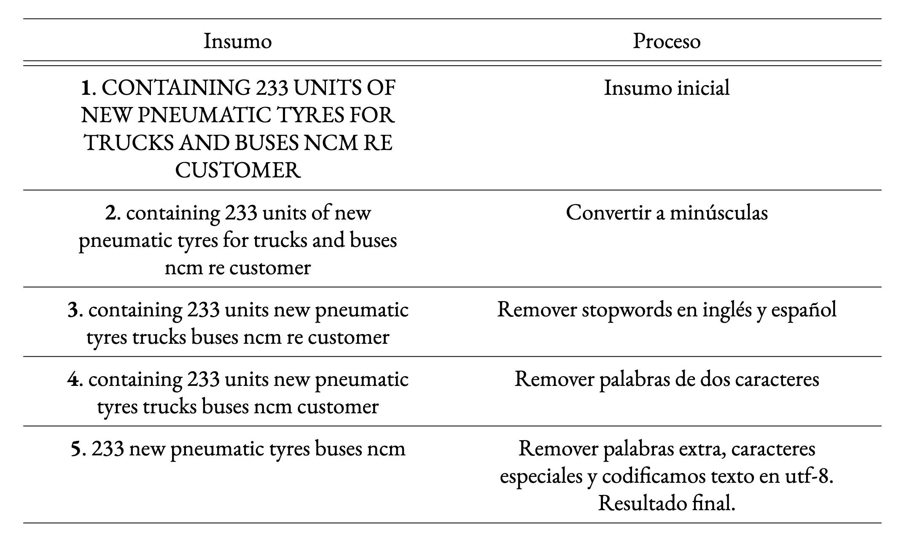

:::
::::

## Paso 2: catálogo HS

:::: {.columns}
::: {.column style="width:30%; font-size: 0.7em;"}

- El Sistema Armonizado (HS) se usa para clasificar productos comerciales internacionalmente.
    - 21 secciones
    - 97 capítulos
- Se buscó el código armonizado usando la palabra *code* y los dos dígitos siguientes:
    - ej. `graphite l hs code 8249965 etc saskia`
- Solo el 25% de las mercancías tenía esta clasificación.

:::
::: {.column width="5%"}
<!-- empty column to create gap -->
:::
::: {.column style="width:60%; font-size: 0.6em;"}

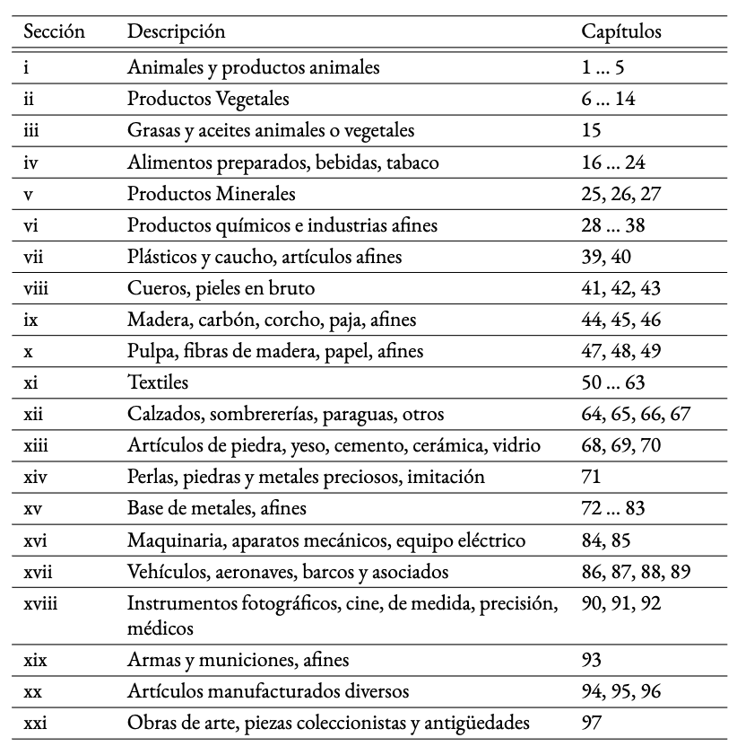

:::
::::

## Paso 3: clasificación con modelo

- Antes de este paso: **75%** de las mercancías seguían sin clasificar.
- Al final del proceso: alrededor de **88%** quedó clasificada.

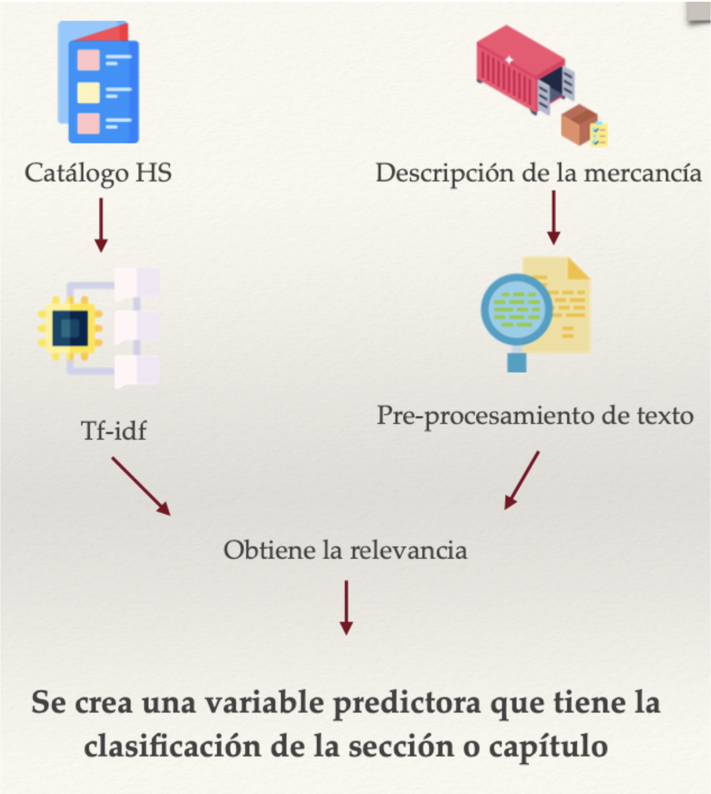


# Caso: Clasificación del delito {background-color="#fdede8"}

## Clasificación del delito
### Contexto

- Artículo: *Text mining and machine learning for crime classification: using unstructured narrative court documents in police academic*
	- @bifari2024text

Objetivo: Desarrollar un sistema automático de clasificación de delitos utilizando:

- Documentos narrativos judiciales
- Texto no estructurado
- Casos etiquetados por tipo de delito


## Clasificación del delito

Se construye un modelo de Machine Learning en dos fases.

- Modelo 1: *Crime Scene Existence* (CSE)
	- Determina si el documento contiene información sobre la escena del crimen.
	- Es una clasificación binaria (sí / no).

- Modelo 2: *Crime Type* (CT)
	- Determina el tipo de delito cometido según el contexto del texto.
	- Es una clasificación multiclase.

Ambos modelos utilizan vectores TF-IDF como representación del texto.

:::{.notes}
- Entrenan clasificadores supervisados con sus respectivas etiquetas.

Para el modelo CT:

- Solo se utilizan los documentos que fueron clasificados como positivos por el modelo CSE.
:::


## Pipeline

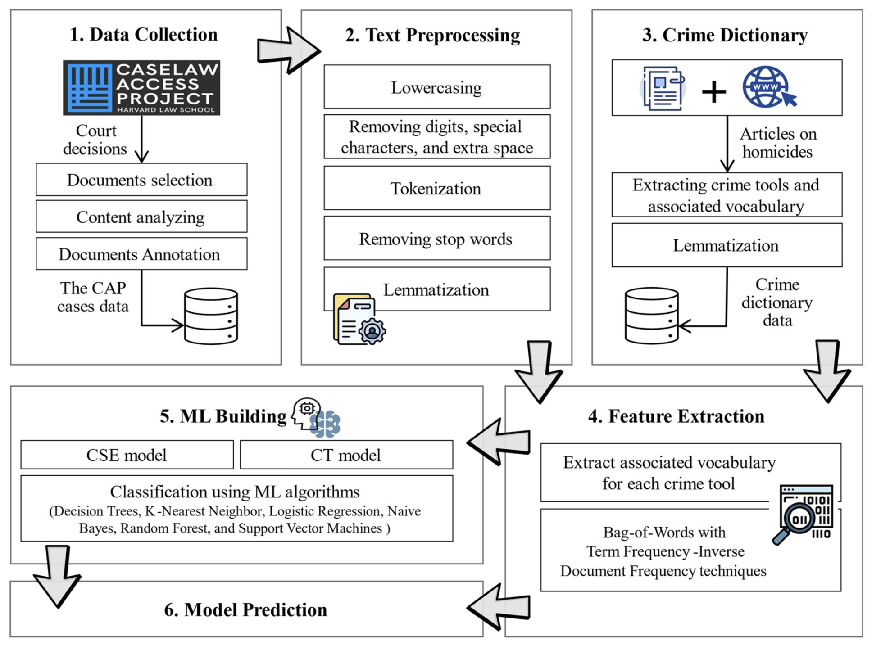

## Resultados


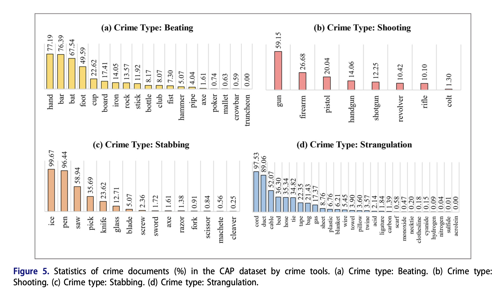

## Resultados


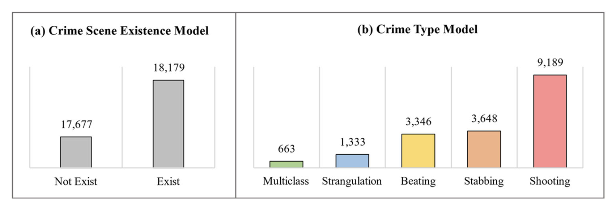

## Referencias
