## Sabemos que los datos pueden mejorar la sociedad... pero no de forma automática

Las herramientas de ciencia de datos han transformado la forma en que los gobiernos toman decisiones: desde asignar recursos hasta detectar fraude o focalizar programas sociales.

Pero esta capacidad no viene sola: viene acompañada de preguntas que **no tienen respuesta técnica**.

> Debemos estar de acuerdo con no tener todas las respuestas, pero sí con plantear preguntas que puedan ser informadas empíricamente.

## Nuestras políticas reflejan nuestros valores

- Las cuestiones éticas **siempre** han existido en la toma de decisiones públicas.
- Antes de construir cualquier modelo, debemos hacer explícitas las preguntas de valor que subyacen al diseño:
    - ¿Qué entendemos por **equidad**?
    - ¿Está bien discriminar positivamente a un grupo para alcanzarla?
    - ¿Tiene más peso el derecho a la privacidad que el derecho a la salud o a la seguridad?

. . .

**No existe una única respuesta correcta. Por eso debemos incluir las perspectivas de todos los grupos afectados en el proceso de diseño.**

## Más preguntas que debemos hacernos:

Antes de iniciar cualquier proyecto de datos con impacto en personas, conviene hacerse estas preguntas [@fosterBigDataSocial2021]:

- ¿Estás utilizando los datos para los fines para los que fueron recopilados?
- ¿Cómo estás protegiendo los datos?
- ¿Las personas que "poseen" los datos saben que los estás utilizando?
- ¿Tienes su consentimiento? ¿Cómo fue obtenido?
- ¿Las personas afectadas saben por qué están siendo intervenidas?
- ¿Qué recursos tienen para impugnar una decisión?
- ¿La noticia de lo que haces sería un escándalo en la portada del NYT?

::: {.notes}
Esta última pregunta —el "test del NYT"— es una heurística práctica para evaluar si una decisión resistiría el escrutinio público. No es un sustituto del análisis ético, pero es un buen punto de partida para detectar problemas evidentes.
:::

## El mapa de problemas éticos en IA

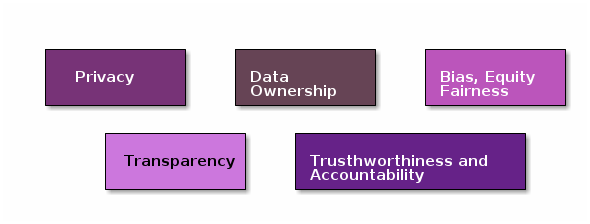

# Privacidad {background-color="#fdede8"}

## Privacidad

La privacidad no es un estado binario (datos públicos vs. datos secretos). 

:::: {.columns}
::: {.column style="width:60%; font-size: 0.9em;"}

- Comprende distintas dimensiones de control [@fosterBigDataSocial2021]: 
    - qué información se recopila, 
    - quién puede acceder a ella, 
    - qué se puede inferir y 
    - qué acciones se pueden tomar a partir de ella. 

:::
::: {.column width="5%"}
<!-- empty column to create gap -->

:::
::: {.column style="width:35%; font-size: 0.6em;"}

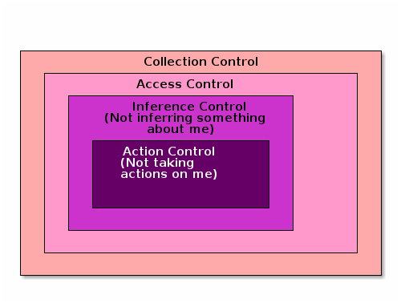

:::
::::

## Privacidad: ¿qué queremos controlar?

**Ejemplo:** Una institución pública utiliza datos para identificar hogares vulnerables.

| Nivel | Pregunta central | Ejemplo de protección |
|---|---|---|
| **Collection** | ¿Qué datos recopilan? | Recopilar únicamente los datos necesarios. |
| **Access** | ¿Quién puede verlos? | Restringir el acceso a personal autorizado. |
| **Inference** | ¿Qué pueden deducir sobre mí? | Limitar inferencias sobre atributos sensibles. |
| **Action** | ¿Qué pueden hacer con esa información? | Impedir ciertos usos automatizados que afecten a las personas. |

::: {.callout-important}
**Proteger los datos no es lo mismo que proteger a las personas de las consecuencias de su uso.**
:::

Incluso si nadie accede directamente a nuestros datos personales, un modelo puede producir inferencias que afectan nuestras oportunidades.

::: {.notes}
- **(No recopilar mis datos)**: el nivel más fuerte de protección.
- **(No dar acceso a mis datos)**: control de acceso una vez que los datos existen.
- **(No inferir algo sobre mí)**: el nivel más difícil de proteger: incluso datos "no sensibles" pueden combinarse para revelar información íntima.

A medida que descendemos en estos niveles, los controles deben ser más estrictos, porque el daño potencial es mayor y más difícil de detectar.
:::

## Anonimizar no basta

- Quitar el nombre o el RFC no garantiza el anonimato.
- Con solo **código postal, sexo y fecha de nacimiento**, Sweeney (2000) identificó de forma única a cerca del 87% de la población de Estados Unidos [@sweeneySimpleDemographics2000].
- Narayanan y Shmatikov (2008) re-identificaron usuarios del conjunto de calificaciones de Netflix cruzándolo con datos públicos de IMDb [@narayananRobustDeanonymization2008].

::: {.callout-important collapse="false"}
El riesgo no está en un archivo aislado, sino en la combinación de variables. 

- ¿Qué variables de sus registros administrativos podrían funcionar como identificador aunque no tengan nombre?
:::

::: {.notes}
Ambas tienen un costo: la anonimización reduce utilidad, y la privacidad diferencial vuelve ruidosas las estimaciones pequeñas, por ejemplo las de una colonia o un municipio pequeño. Eso conecta directamente con la focalización de programas: más privacidad puede significar menos precisión local.
:::

## Marco legal de la privacidad en el sector público

- **México:** La Ley General de Protección de Datos Personales en Posesión de Sujetos Obligados (2025) regula el tratamiento de datos personales por instituciones públicas.
    - Principios: finalidad, proporcionalidad, licitud, información, seguridad y responsabilidad.     
    - Las personas cuentan con derechos **ARCO**: acceso, rectificación, cancelación y oposición.

- **Unión Europea:** El Reglamento General de Protección de Datos (**GDPR**) establece garantías frente a decisiones automatizadas
    - Las instituciones deben justificar para qué utilizan los datos, limitar su tratamiento y considerar las garantías aplicables al implementar sistemas automatizados.

# Transparencia {background-color="#fdede8"}

## ¿Qué significa que un análisis sea transparente?

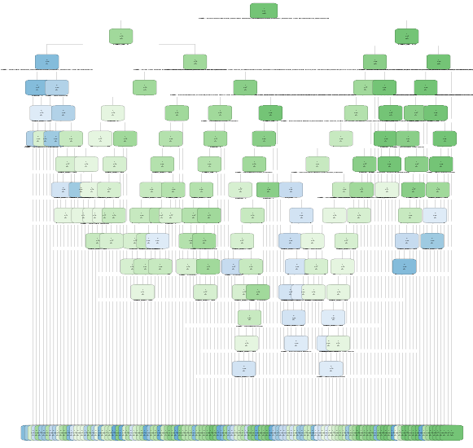

## ¿Qué se necesita para que un análisis sea realmente transparente?

Responder preguntas en múltiples niveles:

- **El proceso**: ¿qué hace el pipeline? 
- **El control**: ¿quién diseñó el proceso y quién puede modificarlo?
- **Los datos**: ¿qué datos se usaron? ¿Con qué limitaciones?
- **El objetivo**: ¿qué se le pidió estimar al modelo?
- **El desempeño**: ¿qué tan bien cumplió su objetivo?
- **El impacto**: ¿cómo afectó a distintos grupos de personas?

La falta de transparencia en cualquiera de estos niveles **es un riesgo ético**, no solo técnico.

## Transparencia no es lo mismo que explicabilidad

| Concepto | Pregunta que responde |
|---|---|
| Transparencia | ¿Qué sistema existe, para qué sirve y quién lo opera? |
| Explicabilidad | ¿Por qué se tomó esta decisión concreta? |
| Rendición de cuentas | ¿Quién responde cuando el sistema falla? |

::: {.callout-note collapse="false"}

Una institución puede ser:

- Transparente porque publica que usa un sistema,
- sin ser explicable, nadie puede decir por qué un caso salió mal. 

La rendición de cuentas necesita ambas. Ejemplo: un registro público que dice "usamos un modelo de riesgo" es transparencia; que el solicitante sepa qué variables pesaron en su caso es explicabilidad.

:::

## Explicaciones globales y locales

- **Globales:** qué variables pesan más en el modelo en general.
- **Locales:** por qué un caso específico recibió una puntuación determinada.
- Herramientas comunes: 
    - LIME [@ribeiroWhyShouldTrust2016] 
    - SHAP [@lundbergUnifiedApproach2017].
- **Advertencia:** una explicación puede ser fiel al modelo y aun así no ser comprensible ni útil para la persona afectada.

::: {.notes}
Distinguir entre explicar el modelo y justificar la decisión. SHAP dice qué contribuyó a la predicción; no dice si esa contribución era legítima.
:::

# Sesgo, justicia y equidad {background-color="#fdede8"}

## El sesgo puede filtrarse en cada paso del pipeline

Desde la definición del problema hasta la implementación, cada decisión de diseño es una oportunidad para introducir o amplificar sesgos [@saleiroAequitasBiasFairness2019].

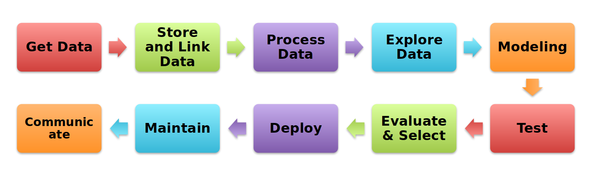{width="800px"}

## Las fuentes del sesgo son múltiples

El sesgo no aparece solo en el algoritmo. Se puede introducir en **cada etapa del proceso**:

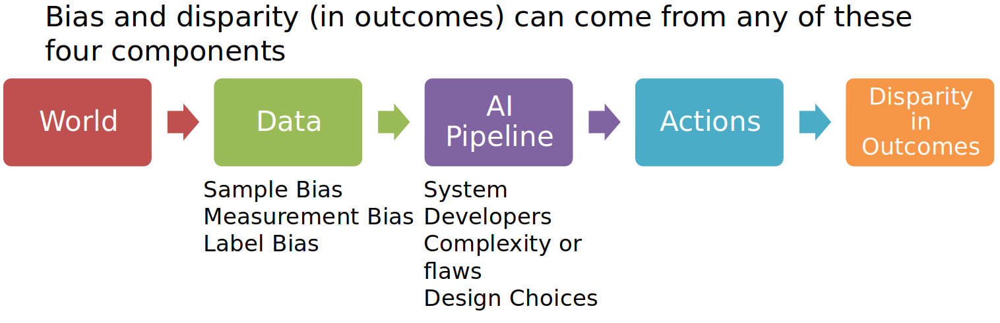{width="800px"}

## El objetivo no es solo un modelo justo: es un sistema justo

Un modelo puede ser estadísticamente "justo" y aun así producir resultados inequitativos. El foco debe estar en **todo el sistema** y en sus resultados reales sobre las personas.

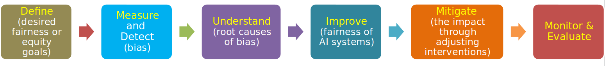{width="800px"}

## Conceptos base para medir equidad

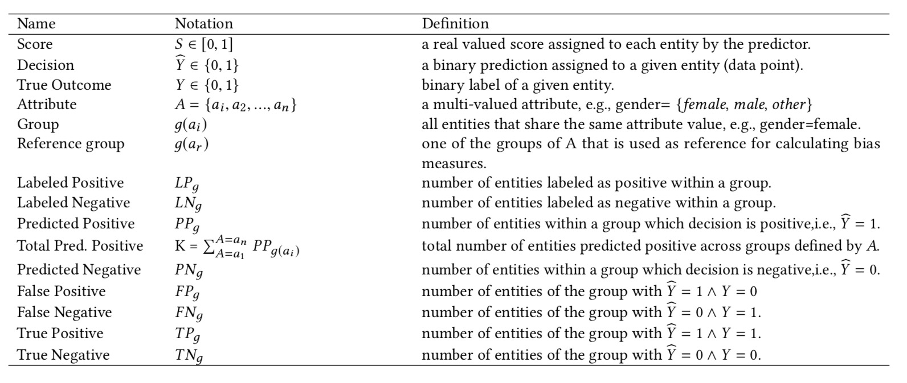{width="800px"}

## Métricas de equidad

Podemos calcular tasas que nos ayudan a evaluar la equidad en las predicciones:

:::: {.columns}
::: {.column style="width:45%; font-size: 0.8em;"}

<small>

- **Tasa de falsos positivos (FPR)**: fracción de entidades con etiquetas reales negativas que el modelo clasifica erróneamente como positivas.
- **Tasa de falsos negativos (FNR)**: fracción de entidades con etiquetas reales positivas que el modelo clasifica erróneamente como negativas.
- **Tasa de falsos descubrimientos (FDR)**: fracción de entidades a quienes el modelo predice positivo, pero la etiqueta real es negativa.
- **Tasa de omisiones falsas (FOR)**: fracción de entidades a quienes el modelo predice negativo, pero la etiqueta real es positiva.

</small>

:::

::: {.column width="5%"}
<!-- espacio vacío -->
:::

::: {.column style="width:50%; font-size: 0.8em;"}

<small>

- **Prevalencia real**: fracción de entidades dentro de un grupo donde el resultado fue positivo.
- **Prevalencia predicha**: fracción de entidades dentro de un grupo predichas como positivas.
- **Precisión (Precision)**: fracción de predicciones positivas que son correctas.
- **Cobertura (Recall)**: fracción de casos positivos reales que el modelo identificó correctamente.

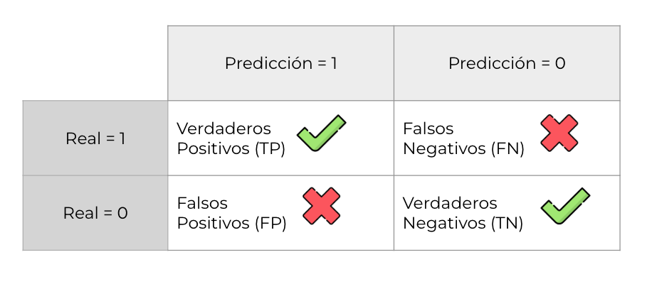

</small>

:::
::::

## Métricas de equidad

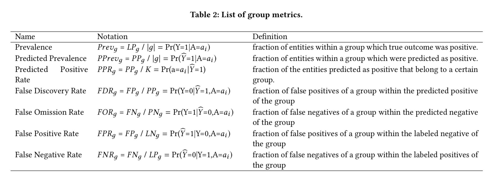{width="800px"}

- **La diferencia está en el denominador:** ¿condicionamos en la predicción del modelo o en la realidad observada?

- Todas estas métricas son válidas. El problema es que **no se pueden satisfacer todas al mismo tiempo** cuando los grupos tienen prevalencias distintas [@chouldechovaFairPredictionDisparate2017; @kleinbergInherentTradeOffs2017].

## ¿Qué comparan las métricas de equidad?

Las métricas evalúan distintas dimensiones de equidad según **qué población utilizamos como referencia**.

| Métrica | Pregunta que responde |
|---|---|
| **Statistical Parity** | ¿Los grupos reciben decisiones positivas con la misma frecuencia? |
| **False Discovery Rate (FDR)** | De quienes fueron clasificados como positivos, ¿qué proporción fue clasificada incorrectamente? |
| **False Omission Rate (FOR)** | De quienes fueron clasificados como negativos, ¿qué proporción fue clasificada incorrectamente? |
| **False Positive Rate (FPR)** | De quienes realmente son negativos, ¿qué proporción fue clasificada incorrectamente como positiva? |
| **False Negative Rate (FNR)** | De quienes realmente son positivos, ¿qué proporción fue clasificada incorrectamente como negativa? |

## El algoritmo COMPAS

COMPAS (*Correctional Offender Management Profiling for Alternative Sanctions*) es un sistema de puntuación de riesgo de reincidencia utilizado en tribunales de Estados Unidos para apoyar decisiones de fianza y libertad condicional.

- En 2016, ProPublica publicó una investigación que concluyó que COMPAS **estaba sesgado contra personas negras** [@angwinMachineBias2016].

- Northpointe, la empresa creadora, respondió que el modelo **era justo** [@dieterichCompasRiskScales2016].

- *¿Cómo pueden llegar a conclusiones opuestas sobre los mismos datos?*

## Los datos del caso

    Métrica                  Caucásico   Afroamericano
  ------------------------- ----------- ------------------
  Tasa de falsos positivos   23%         45%
  Tasa de falsos negativos   48%         28%

ProPublica identificó disparidades considerables:

-   El algoritmo tenía el doble de probabilidades de *predecir incorrectamente* que los individuos negros tenían un alto riesgo de reincidencia (FPR).

-   También tenía casi el doble de probabilidades de *predecir incorrectamente* que los individuos blancos tenían un bajo riesgo de reincidencia (FNR).

## La respuesta de Northpointe

   Métrica                         Caucásico   Afroamericano
  ------------------------------ ----------- ------------------
  Tasa de falsos positivos         23%         45%
  Tasa de falsos negativos         48%         28%
  Tasa de falsos descubrimientos   41%         37%

Sin embargo, Northpointe señaló que el modelo estaba bien balanceado en **precisión entre razas**: 

- **False Discovery Rate (FDR)**: De quienes fueron clasificados con riesgo de incidencia, pero realmente no reincidieron.

::: {.notes}
Del libro @fosterBigDataSocial2021:

"ProPublica se centró en FPR y FNR. En su respuesta, Northpointe argumentó que FDR debería ser el enfoque: si el modelo te etiqueta como de alto riesgo, ¿la probabilidad de que esté equivocado depende de tu raza? Bajo esta definición, COMPAS es justo: el 37% de los acusados negros etiquetados como de alto riesgo no reincidieron, vs. el 41% de los blancos."
:::

## El significado detrás de los números

**Modelo: ¿Riesgo de que la persona reincida?**

  ---------------------------------------------------------------------------------------------------------
  Métrica   Significado                                                         Caucásico   Afroamericano
  --------- ------------------------------------------------------------------ ----------- ----------------
  FPR       Si eres una persona que **no** reincidirás, ¿la probabilidad        23%         45%
            de ser clasificado como alto riesgo depende de tu etnicidad?

  FNR       Si eres una persona que **sí** reincidirá, ¿la probabilidad de      48%         28%
            ser clasificado como bajo riesgo depende de tu etnicidad?

  FDR       Si el modelo te clasifica como alto riesgo, ¿la probabilidad de     41%         37%
            que esté equivocado al hacerlo depende de tu etnicidad?
  
  ---------------------------------------------------------------------------------------------------------

## ¿Quién tiene razón?

- ¿El algoritmo COMPAS es sesgado?
- ¿No puede el algoritmo lograr ambas medidas de equidad al mismo tiempo?

La respuesta es **no**: matemáticamente es imposible satisfacer ambas condiciones cuando los grupos tienen tasas de reincidencia distintas.

::: {.notes}
Nota importante: COMPAS no es un modelo de machine learning moderno. Es un instrumento propietario que combina un cuestionario con un modelo estadístico; sus detalles no son públicos.
:::

## La incompatibilidad es matemática, no técnica

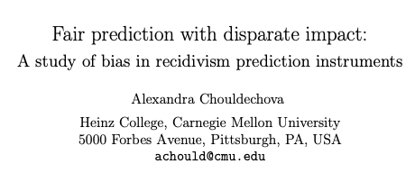

Chouldechova (2017) y Kleinberg, Mullainathan y Raghavan (2017) demostraron de forma independiente que, cuando dos grupos tienen **tasas base distintas** en el resultado de interés, ningún clasificador puede satisfacer simultáneamente calibración e igualdad en tasas de error. Las únicas excepciones son dos casos especiales: predicción perfecta o tasas base iguales [@chouldechovaFairPredictionDisparate2017; @kleinbergInherentTradeOffs2017].

## Entonces... ¿qué significa esto?

- No podemos tenerlo todo.
- Pero esto **no significa** que la equidad sea inalcanzable ni que no valga la pena intentarlo.
- Significa que debemos **elegir explícitamente** qué métrica de equidad importa más en nuestro contexto y **justificar esa elección**.

El debate no es técnico: es un debate sobre valores y sobre quién asume el costo de los errores.

## ¿Cómo elegimos qué métrica nos importa?

La elección de métricas de equidad debe hacerse en función del **contexto de intervención** [@saleiroAequitasBiasFairness2019]:

- **Intervención punitiva** (encarcelar, sancionar): los falsos positivos son muy costosos → priorizar FPR.
- **Intervención asistencial** (becas, subsidios, atención médica): los falsos negativos son muy costosos → priorizar FNR/FOR.
- **Recursos limitados**: cuando solo puedes intervenir en una pequeña fracción de la población necesitada, la precisión (FDR) importa más.

No existe una respuesta única. Lo importante es **hacer explícita la elección y sus implicaciones**.

## El Árbol de Equidad

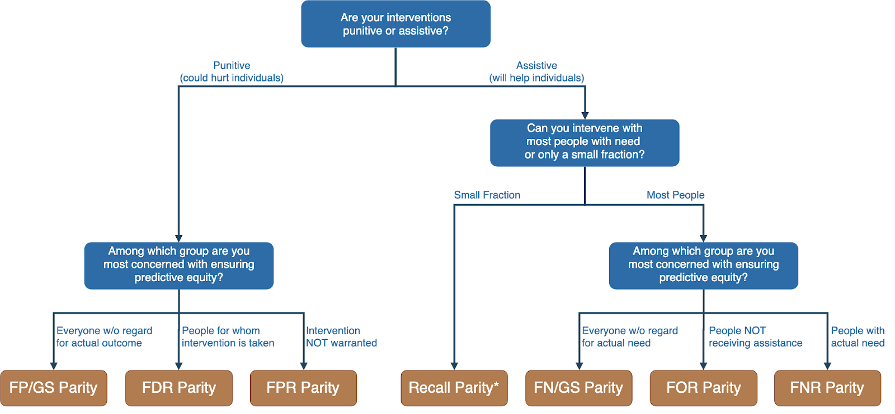{width="800px"}

## Elección de métricas: paso a paso

1. **Proporcionar todas las métricas** disponibles en la auditoría de equidad.
2. **Evaluar el contexto tangible**: ¿es una intervención punitiva o asistencial? ¿Hay recursos limitados?
3. **Seleccionar la métrica prioritaria** en función del daño que queremos minimizar.
4. **Observar disparidades** en esa métrica a través de los grupos protegidos.
5. **Documentar y justificar** la elección ante las partes interesadas.

---

## Aequitas: herramienta de código abierto para la auditoría de sesgo y equidad

- **Web interactiva**: @AequitasBiasReport
- **Documentación**: @BiasFairnessAudit
- **Artículos**: @saleiroAequitasBiasFairness2019; @saleiroDealingBiasFairness2020

Permite auditar modelos de clasificación binaria en múltiples grupos y métricas, y genera reportes interpretables para equipos técnicos y de política pública.

## Flujo de trabajo de equidad en ML

El trabajo con equidad no termina al construir el modelo: es un ciclo continuo [@saleiroAequitasBiasFairness2019]:

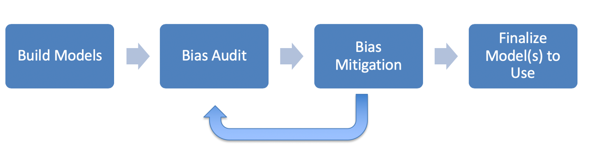{width="800px"}

# Reducir el sesgo: estrategias y compensaciones {background-color="#fdede8"}

## ¿Cómo podemos reducir el sesgo?

Existen intervenciones en distintas etapas del pipeline:

- **Corregir el mundo**: atender las causas estructurales del sesgo en los datos.
- **Preprocesamiento**: corregir los datos de entrada.
  - Remuestrear o reponderar grupos protegidos.
- **Procesamiento interno**: optimizar la equidad durante el entrenamiento del modelo.
- **Posprocesamiento**:
  - Seleccionar modelos justos durante la evaluación.
  - Aplicar ajustes post hoc para eliminar sesgo de las puntuaciones.

## Estrategias de mitigación de sesgo

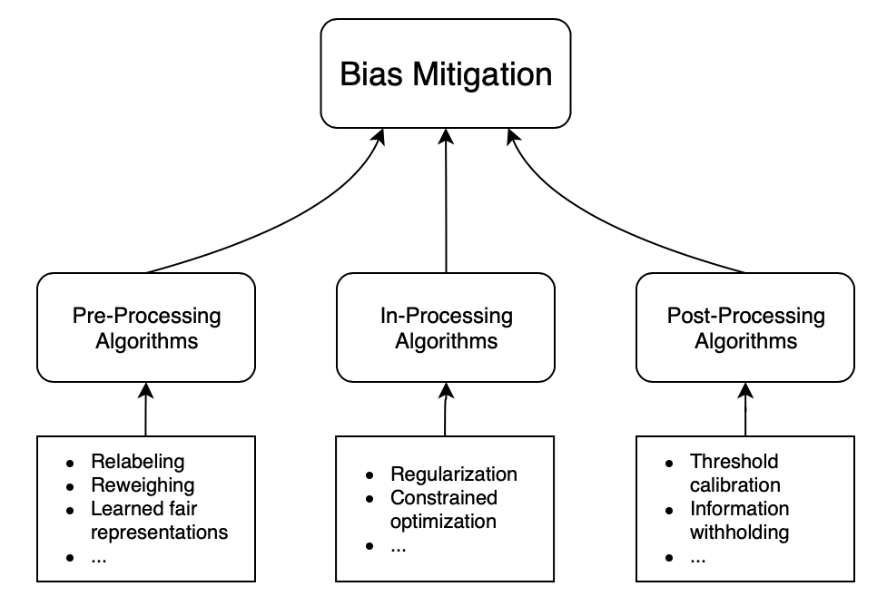{width="800px"}

## Explorando las compensaciones (equity-accuracy tradeoffs)

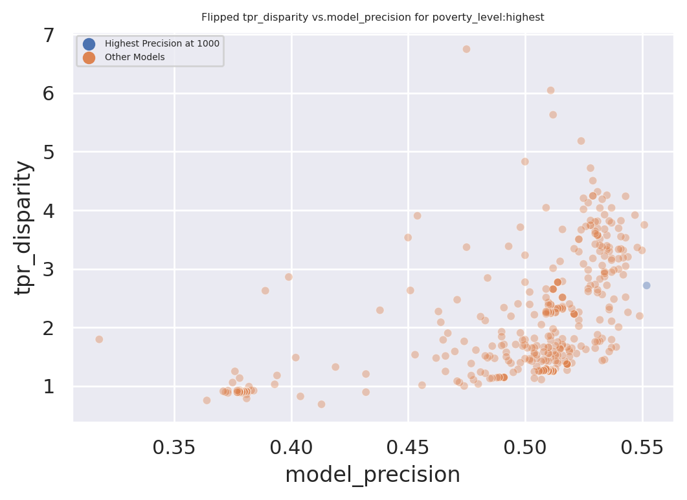{width="800px"}

::: {.notes}
- Cada punto representa una especificación diferente del modelo.
- Los puntos más a la derecha son más precisos.
- Los puntos más cercanos a 1 en el eje Y son más justos (en la métrica seleccionada).
- El azul representa el "mejor" modelo basado únicamente en precisión en k puntos.

La lección: maximizar precisión y maximizar equidad no siempre apuntan en la misma dirección, pero tampoco son objetivos irreconciliables en todos los contextos.
:::

---

### Percepciones (erróneas) comunes entre profesionales

Estas ideas suenan razonables pero son incorrectas o incompletas:

- *"No considerar la raza en mis modelos los hace no racistas."*
- *"Usar la raza en mis modelos los vuelve racistas."*
- *"El sesgo surge y se puede corregir solo 'corrigiendo' los datos."*
- *"Debo eliminar todo sesgo para poder implementar el sistema."*
- *"Debo cumplir con todas las medidas de sesgo para ser justo."*
- *"Siempre existe un equilibrio entre imparcialidad y precisión."*
- *"Un modelo de ML justo = resultados justos y equitativos."*
- *"Los métodos de reducción de sesgo realmente reducen el sesgo en el mundo real."*

---

### ¿Cómo prepararse para construir sistemas más justos?

- **Crear un entorno de discusión**: donde se puedan debatir valores desde el inicio del proyecto, no al final.
- **Involucrar a los afectados**: incluir en el diseño a las comunidades sobre las que opera el sistema.
- **Analizar opciones en cada etapa**: desde la formulación hasta el impacto, no solo en el modelado.
- **Medir los resultados correctos**: no solo métricas de desempeño técnico.
- **Probar con las pruebas correctas**: equidad en distribuciones reales, no solo en datos de entrenamiento.
- **Adaptar el diseño al escenario de implementación**: las decisiones de diseño que son éticas en un contexto pueden no serlo en otro.

# IA generativa, documentación y regulación {background-color="#fdede8"}

## ¿Qué cambia con la IA generativa?

- Los modelos de lenguaje y de imagen se entrenan con corpus enormes, rara vez documentados.
- Producen texto plausible pero no verificado: las **alucinaciones** son un riesgo central.
- Pueden reproducir sesgos del corpus y amplificarlos en textos que parecen neutrales.
- Escalan rápido: una decisión de diseño llega a millones de usuarios a la vez.

::: {.notes}
Las métricas de las secciones anteriores son para clasificación binaria: una predicción por caso, con un resultado verdadero. En IA generativa la salida es abierta y no hay una etiqueta única contra la cual medir el error. Por eso la evaluación y la documentación se vuelven tan importantes.
:::

## Los riesgos de escalar modelos de lenguaje

Bender, Gebru, McMillan-Major y Mitchell (2021) plantean tres preocupaciones [@benderStochasticParrots2021]:

- **Costos ambientales y financieros** de entrenar modelos cada vez más grandes.
- **Datos opacos:** no sabemos bien qué contienen ni quién los produjo.
- **Riesgo de reproducir patrones** sin comprensión, y de ocultar sesgos detrás de textos fluidos.

::: {.notes}
El artículo es polémico. Su metáfora de los "loros estocásticos" ha sido criticada: Yoav Goldberg (2021) argumenta que muchos de sus riesgos son de los modelos de lenguaje en general, no exclusivos de los grandes. Presentarlo como un debate abierto, no como una verdad establecida. Pregunta a la clase: ¿cuánto cuesta en energía y datos un modelo que su institución podría usar?
:::

## Documentar para rendir cuentas

| Documento | Qué describe | Propuesto por |
|---|---|---|
| *Datasheet for datasets* | Origen, composición, recolección, usos previstos y no previstos del conjunto de datos | Gebru et al. [@gebruDatasheets2021] |
| *Model card* | Uso previsto, desempeño por subgrupos, limitaciones y condiciones de evaluación | Mitchell et al. [@mitchellModelCards2019] |

::: {.notes}
Son documentación, no garantías. Un documento completo no evita un mal uso, pero obliga a la institución a responder preguntas que de otro modo se omiten, como ¿para qué NO debe usarse este modelo? Conectar con la sección de transparencia: estos documentos son la forma práctica de hacerla.
:::

## Auditorías algorítmicas

@rajiClosingAIAccountability2020 proponen una auditoría interna de punta a punta: desde la definición del problema hasta el monitoreo posterior al despliegue.

- Auditoría **interna** (antes del despliegue) y **externa** (por terceros).
- Evidencia documentada en cada etapa del ciclo de vida.
- Brecha: el *AI Index 2025* de Stanford reporta que las empresas reconocen los riesgos de IA responsable, pero actúan poco sobre ellos [@stanfordAIIndex2025].

::: {.notes}
Esta brecha entre reconocer y actuar es uno de los hallazgos más citados sobre la práctica actual. Pregunta para la clase: ¿qué evidencia pediría antes de aprobar el despliegue de un sistema en su institución?
:::

## Ética de fachada (*ethics washing*)

- **Principios sin procesos:** códigos de ética que no cambian ninguna decisión.
- **Comités sin poder:** comités de ética que no pueden vetar un proyecto.
- **Señales de que la ética es decorativa:** no hay evaluación de impacto, no hay participación de las personas afectadas y no hay consecuencias cuando algo falla.

::: {.notes}
Esta crítica aplica a gobiernos, universidades y empresas por igual. Pregunta para la clase: ¿qué compromiso concreto de un proyecto propio sería verificable dentro de seis meses?
:::

## Principios internacionales: soft law

- **OCDE** (2019, actualizados en 2024): principios para una IA confiable, inclusiva, transparente, robusta y con rendición de cuentas [@oecdAIPrinciples2019].
- **UNESCO** (2021): Recomendación sobre la ética de la IA, adoptada por los Estados miembros. Pone énfasis en derechos humanos, diversidad, medio ambiente y supervisión humana [@unescoRecommendationEthicsAI2021].
- Son **no vinculantes**: su fuerza depende de quien los implemente.

::: {.notes}
Verificar la fecha exacta de la actualización de los principios de la OCDE antes de citarla. La distinción clave es entre principios (qué queremos) y leyes (qué es obligatorio).
:::

## Regulación vinculante: la AI Act de la Unión Europea

- Enfoque basado en **riesgo**: prácticas prohibidas, alto riesgo, riesgo limitado y riesgo mínimo [@euAIAct2024].
- Las prácticas prohibidas, como la puntuación social por parte de autoridades públicas, aplican desde febrero de 2025.
- Los sistemas de **alto riesgo** incluyen el acceso a servicios públicos esenciales y prestaciones sociales. Sus obligaciones se han pospuesto con el paquete *Omnibus*: verificar las fechas vigentes en el Diario Oficial.

::: {.notes}
Para una audiencia de política pública, este es el punto más relevante: un sistema que decide sobre apoyos sociales cae en la categoría de alto riesgo. Las fechas están en revisión, así que antes de la clase hay que consultar la versión vigente.
:::

## Regulación en la práctica: evaluación de impacto algorítmico

- **Canadá:** la Directiva sobre Decisiones Automatizadas (2019) exige una evaluación de impacto algorítmico antes de desplegar sistemas en la administración federal [@canadaDirectiveADM2019].
- Preguntas para diseñar una evaluación:
    - ¿Qué decisión se automatiza?
    - ¿Qué tan reversible es el error?
    - ¿Quiénes son las personas afectadas?
    - ¿Qué datos se usan y qué medidas de mitigación existen?

::: {.notes}
La evaluación de impacto obliga a pensar en el sistema completo, no solo en el modelo, lo que conecta con la idea de "un sistema justo" de la sección de sesgo. Pedir a la clase que proponga una evaluación de impacto para un caso de su institución.
:::

## Debate: ¿principios, leyes o auditorías?

- **Principios:** flexibles, pero sin dientes.
- **Leyes:** exigibles, pero lentas, y pueden quedar rezagadas frente a la tecnología.
- **Auditorías:** dan evidencia concreta, pero dependen de métricas que ya vimos que son incompatibles entre sí.
- ¿Qué instrumento conviene para cada nivel de riesgo?

::: {.notes}
Cerrar el bloque conectando con la primera sección: elegir una métrica de equidad también es una decisión política sobre qué instrumento y qué costos se aceptan. No hay un instrumento único; la combinación depende del contexto.
:::

# Preguntas para discutir {background-color="#fdede8"}

1. Si un modelo predice mejor, pero sus errores caen más en un grupo, ¿qué prioriza su institución?
2. ¿Qué datos administrativos de su trabajo podrían usarse para identificar personas aunque no tengan nombre?
3. Si un algoritmo recomienda y un funcionario decide, ¿quién es responsable del resultado?
4. ¿Debe toda persona poder pedir que una decisión automatizada sea revisada por un humano?
5. Un gobierno quiere usar IA generativa para resumir expedientes de solicitantes de apoyo. ¿Qué evaluarían antes de aprobarlo?

::: {.notes}
Tiempo sugerido: 15 minutos. Pedir que respondan primero en silencio por escrito, luego en parejas. Anotar las respuestas: sirven como insumo para la discusión del siguiente bloque.
:::

## Recapitulando

- Las preguntas éticas en datos no son nuevas, pero la **escala y opacidad** de los sistemas de IA las amplifican.
- La **privacidad** tiene múltiples niveles de control; la inferencia es el nivel más difícil de proteger.
- La **transparencia** va mucho más allá de publicar código: involucra procesos, datos, objetivos e impacto.
- Existen **muchas métricas de equidad** y son matemáticamente incompatibles cuando los grupos tienen prevalencias distintas.
- El objetivo final es un **sistema justo**, no solo un modelo justo.
- La **IA generativa** amplifica los problemas de datos, sesgo y documentación; la **documentación**, las **auditorías** y la **regulación** son instrumentos concretos, más allá de los principios.

## Recursos útiles

- [Guía de alcance de proyectos de ciencia de datos para el bien público](http://dsapp.uchicago.edu/resources/data-science-project-scoping-guide/)
- [Aequitas — herramienta de auditoría de sesgo](http://aequitas.dsapp.uchicago.edu/)
- [Tutorial práctico sobre equidad y sesgo (Jupyter notebooks)](https://dssg.github.io/fairness_tutorial/)
- [Repositorio de proyectos DSSG](https://www.github.com/dssg)
- [Triage: kit de herramientas de aprendizaje automático](https://github.com/dssg/triage)

## Referencias {.unnumbered}

::: {#refs}
:::
