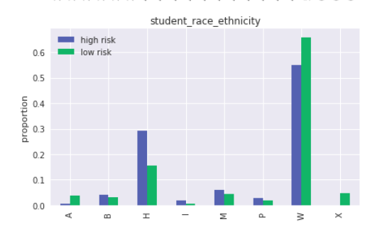
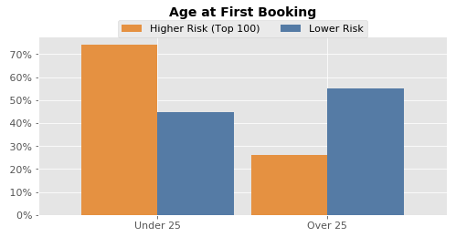
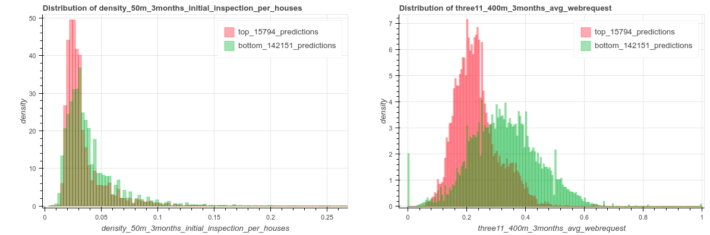
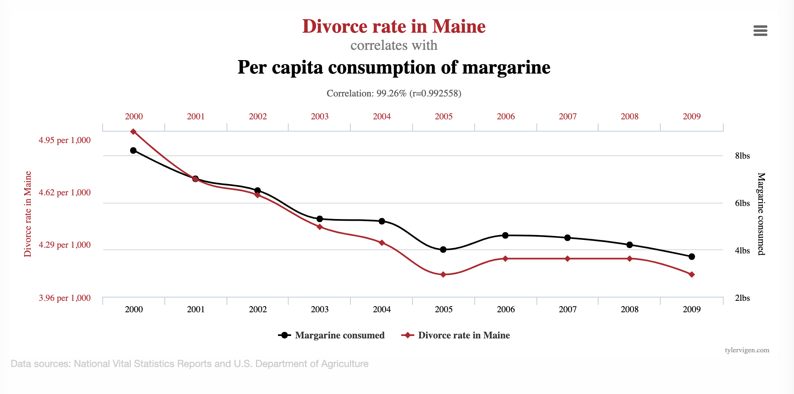
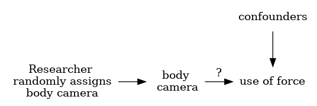
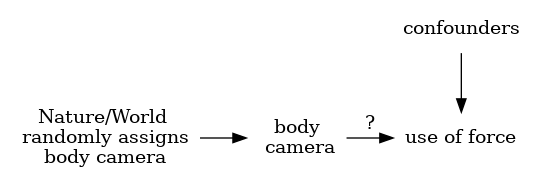
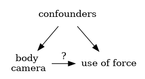
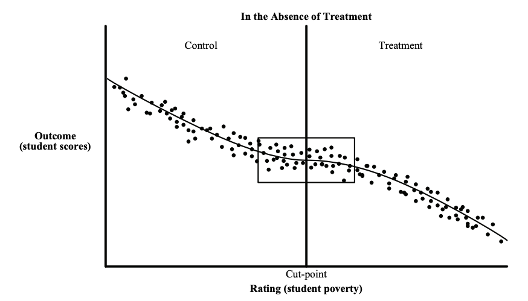
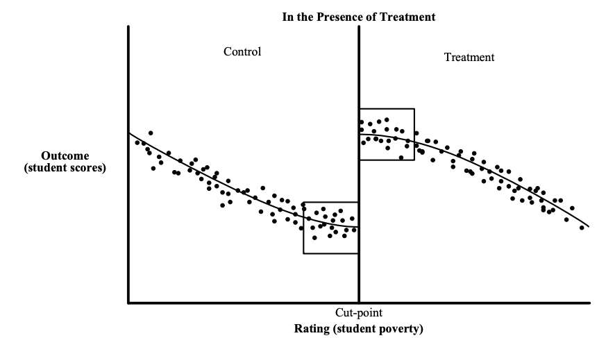
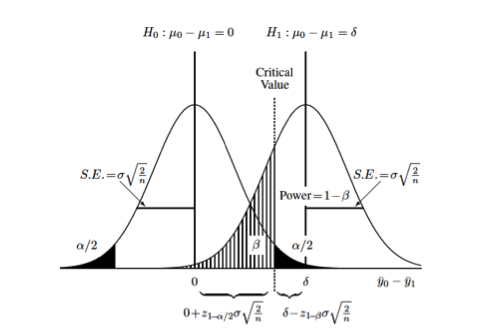

# Postmodelado {background-color="#fdede8"}


## Entender lo que el modelo está haciendo

- Ver el modelo (hiperparámetros)

- Ver las distribuciones de score y calibración

- Ver las *feature importances*

- Ver las contribuciones de *feature groups* o grupos de variables

- Cross-Tabs sobre las predicciones

- Análisis de error

::: {.notes}
Hilo conductor de la clase: después de entrenar, la pregunta ya no es solo "¿qué tan bueno es el modelo?", sino "¿qué está aprendiendo y por qué?". Recorrer la lista con un ejemplo del proyecto del curso. Tiempo sugerido para esta sección: 15 minutos.
:::


## *Leave one out feature groups*

-   (Incremental) Utilidad predictiva de un grupo de variables:

    -   Correr el modelo con todos los grupos de variables
    -   Correr el modelo con un solo grupo de variables
    -   Correr el modelo con todos menos un grupo de variables

::: {.notes}
Esta técnica separa la utilidad de cada grupo. Advertencia: si dos grupos están muy correlacionados, quitar uno puede bajar poco el desempeño aunque ambos sean importantes, porque el otro "compensa". Pregunta para la clase: ¿qué pasaría si quitamos el historial pero dejamos la ubicación? ¿Qué nos diría eso?
:::


## Entiende las predicciones

-   Distribuciones de score

-   Cross-Tabs

-   Clustering

::: {.notes}
Estas tres herramientas responden preguntas distintas: las distribuciones muestran cuántos casos hay en cada rango de riesgo, los cross-tabs comparan grupos y el clustering busca patrones de entidades similares. Las siguientes diapositivas desarrollan cada una.
:::


## Clustering de entidades predichas

-   Agrupar entidades con perfiles similares (por ejemplo, con k-means, visto en la clase de aprendizaje no supervisado).
-   Describir cada grupo con sus variables promedio y con su score promedio.
-   Preguntas útiles:
    -   ¿El riesgo alto se concentra en un tipo de caso o está disperso?
    -   ¿Hay grupos de entidades que el modelo casi nunca marca como riesgo alto?

::: {.notes}
Tiempo sugerido: 5 minutos. Conectar con la clase de aprendizaje no supervisado. La salida útil del clustering no es el número de grupos, sino la descripción de cada uno: ¿qué tienen en común las entidades que el modelo marca? Si no tienes tiempo para una demostración, muestra solo un ejemplo ilustrativo.
:::


## Revisa las entidades predichas en el top k

-   Lista las *k* entidades con mayor score.
-   ¿Son las que esperaríamos? ¿Hay patrones (zona, tipo de caso, antigüedad)?
-   Compara esta lista con la que produce el proceso actual (la línea base).

::: {.notes}
Antes de confiar en las métricas agregadas, lee la lista concreta. Un modelo puede tener buen desempeño promedio y aun así seleccionar casos que nadie consideraría prioritarios. Pedir a la clase que revise diez casos de la lista y diga, con sus palabras, por qué los marcaría o no.
:::


## Cross-Tabs: **Variables categóricas**

1.  Chi-Square Test / Prueba exacta de Fisher

    - **Hipótesis nula:** Los grupos de alto riesgo y bajo riesgo tienen la misma distribución en la *feature* analizada.


{width="500px"}

::: {.notes}
La prueba chi-cuadrado compara la distribución de una variable categórica entre dos grupos. Si las muestras son pequeñas, la prueba exacta de Fisher es más adecuada. En la gráfica, la categoría W tiene mayor proporción en el grupo de bajo riesgo, y H en el de alto riesgo.

Advertencia: una diferencia significativa no prueba causalidad ni discriminación. Puede deberse a otras variables correlacionadas. Pregunta para la clase: ¿qué otra variable podría explicar esta diferencia?
:::


## Cross-Tabs: **Variables categóricas** (otro ejemplo)

{width="800px"}

::: {.notes}
Aquí la variable es la edad al primer ingreso, agrupada en menores y mayores de 25 años. En el grupo de mayor riesgo, la proporción de menores de 25 es más alta que en el de menor riesgo (alrededor de 74% contra 45%, según la gráfica).

Pregunta para la clase: ¿qué sesgo podría introducir usar la edad en un sistema que decide intervenciones? Esto conecta con la sección de sesgo del curso.
:::


## Cross-Tabs: **Continuous Variables**


1. Prueba t de Student

    - **Hipótesis nula:** La media de la *feature* en el grupo de alto riesgo es igual a la del grupo de bajo riesgo.

2. Prueba de Kolmogorov-Smirnov (KS)

    - **Hipótesis nula:** La distribución de la *feature* en el grupo de alto riesgo es igual a la del grupo de bajo riesgo.

{width="800px"}

::: {.notes}
La prueba t compara medias; la KS compara distribuciones completas. Por eso la KS detecta diferencias de forma, por ejemplo colas más pesadas, que la t puede pasar por alto. En la gráfica izquierda, las distribuciones se traslapan mucho; en la derecha, la distribución verde está desplazada hacia valores más altos.

Con muestras grandes, cualquier diferencia pequeña será "significativa". Hay que mirar también el tamaño de la diferencia, no solo el valor p.
:::


# Causalidad y pruebas de campo {background-color="#fdede8"}


## Validación en campo: Más allá de las pruebas A/B

- ¿Qué tan bien funciona el modelo en el mundo real?
  - Validación con datos verdaderamente no vistos del futuro; es la forma más confiable de evitar *leakage* (fugas de información).

- ¿Qué supuestos clave en nuestra formulación deben ser puestos a prueba?
  - ¿Estamos interviniendo con las personas "correctas"?
  - ¿Estamos interviniendo de la mejor manera posible?
  - ¿Cuál es el impacto de decisiones históricas o de etiquetas selectivas?

- Lo más importante: ¿Qué tan bien ayuda el sistema de ML que estamos construyendo a que la organización cumpla sus objetivos?

::: {.notes}
Tiempo sugerido: 5 minutos. Recordar la diferencia entre desempeño predictivo (qué tan bien predice) y desempeño de la intervención (qué tanto cambia el resultado). Un modelo puede predecir muy bien y, aun así, no mejorar nada si la intervención que dispara no funciona.
:::


## Metas de la prueba de campo

- Medir el impacto real del modelo en la organización, no solo su precisión.
- Comprobar supuestos: ¿intervenimos a las personas correctas? ¿Lo hacemos de la mejor forma?
- Detectar si las etiquetas históricas, construidas con decisiones pasadas, afectan la decisión actual.

::: {.notes}
Esta diapositiva resume la lógica de todo lo que sigue. Una prueba de campo responde a tres preguntas: si el modelo funciona fuera de la muestra, si los supuestos del diseño se cumplen y si la organización cumple mejor sus objetivos. Conectar con la sección de sesgo de c10: las etiquetas históricas pueden ser el problema.
:::


## Correlación no es causalidad

{width="800px"}

::: {.notes}
La correlación es de 99%, pero no hay ninguna relación causal entre ambas variables: las dos series tienen tendencias descendentes en el mismo periodo. Muchas correlaciones fuertes vienen de tendencias comunes o de un tercer factor.

Pregunta para la clase: ¿qué variable podría estar detrás de un patrón así en un programa de su institución? Esto motiva la siguiente sección: necesitamos un diseño que aísle el efecto.
:::


---

### ¿Las cámaras corporales (body cameras) en la policía reducen el uso de la fuerza?

```{mermaid}
graph LR
    A[camaras corporales] -->|?| B[uso de la fuerza]

```

¿Qué otras cosas afectan al uso de fuerza?

- El entrenamiento previo del policía,

- La zona o vecindario donde opera (más o menos conflictivo),

- O incluso el turno o experiencia del oficial.

::: {.notes}
Ejemplo guía de la sección. Pedir a la clase que propongan otros factores antes de mostrar la siguiente diapositiva. Tiempo sugerido: 3 minutos.
:::


---

### ¿Las cámaras corporales (body cameras) en la policía reducen el uso de la fuerza?

```{mermaid}
graph TD
    C[factores de confusión] --> A[camaras corporales]
    C --> B[uso de la fuerza]
    A -- ? --> B
```

- Se rompe la interpretación causal directa entre cámara y fuerza.

- Si no se controla por estos confusores:
    - Podemos sobreestimar o subestimar el verdadero efecto de las cámaras.
    - El modelo puede estar detectando correlaciones espurias.

::: {.notes}
Este es el problema de los confusores: un factor que afecta tanto a la variable de tratamiento como al resultado. Si el vecindario determina dónde se instalan las cámaras y también influye en el uso de la fuerza, la comparación directa engaña.
:::


## Diseño experimental

-   Experimentos

-   Quasi-experimentos

-   Estudios observacionales

::: {.notes}
Los tres diseños difieren en quién decide el tratamiento. En un experimento, lo decide el investigador; en un quasi-experimento, una regla o un evento externo; en un estudio observacional, las personas o las instituciones, lo que obliga a controlar confusores.
:::


## Experimento

{width="800px"}

::: {.notes}
El investigador asigna las cámaras al azar. Como la asignación no depende de características de los policías ni de los vecindarios, los grupos son comparables en promedio, y la flecha de confusores desaparece. Por eso el experimento es el estándar de oro para inferir causalidad.
:::


## Quasi-Experimentos

{width="800px"}

::: {.notes}
Aquí la asignación la hace la naturaleza o una regla externa: por ejemplo, un cambio de política que aplica solo en ciertas ciudades, o un umbral que determina quién recibe el tratamiento. No hay aleatorización por parte del investigador, pero el mecanismo de asignación es conocido y se puede aprovechar.
:::


## Estudios observacionales

{width="800px"}

**Incluye los factores confusores en la regresión**

::: {.notes}
Cuando nadie asigna el tratamiento al azar, la única opción es controlar por los confusores que observamos. El riesgo es que existan confusores no observados. Pregunta para la clase: ¿qué factor no medido podría estar generando el sesgo en su proyecto?
:::


## Métodos para inferencia causal

- Uso de datos observacionales
- Uso de experimentos

::: {.notes}
Los métodos de la siguiente sección sirven para datos observacionales; el experimento sigue siendo la referencia cuando es posible.
:::


## Inferencia causal con datos observacionales

- Emparejamiento (Matching)
- Diferencias en diferencias (DiD)
- Diseño de discontinuidad en la regresión (RDD)
- Variables instrumentales
- ¿Limitaciones?

::: {.notes}
Cada método descansa en un supuesto distinto. Emparejamiento supone que controlamos por todos los confusores; DiD supone tendencias paralelas antes del tratamiento; RDD supone que nadie puede manipular la variable de asignación; las variables instrumentales requieren un instrumento que afecte el tratamiento pero no el resultado por otra vía. Las limitaciones son los supuestos: si fallan, la estimación falla.
:::


## Regresión discontinua: el punto de corte

- La asignación depende de una variable continua (una calificación, un puntaje o un umbral).
- Se comparan casos justo por encima y justo por debajo del corte.
- Si el resultado da un salto en el corte, ese salto es el efecto estimado.

::: {.notes}
Idea central del RDD: los casos cercanos al corte son muy parecidos, excepto por haber recibido o no el tratamiento. Por eso el salto en el corte es una estimación local del efecto. Pregunta para la clase: ¿qué pasa si las personas pueden manipular su puntaje para quedar del lado favorable del corte?
:::


## Inferencia causal con datos observacionales

{width="800px"}

::: {.notes}
Sin tratamiento, la relación entre la variable de asignación y el resultado es continua en el corte: no hay salto. Esta es la línea de referencia para comparar.
:::


## Inferencia causal con datos observacionales

{width="800px"}

::: {.notes}
Con tratamiento aparece un salto en el punto de corte, que es el efecto estimado. Las cajas marcan las ventanas de casos cercanos al corte, donde se hace la comparación. Limitación: el resultado es válido cerca del corte, no necesariamente para todas las personas.
:::


## Inferencia causal con experimentos

### *Randomized Controlled Trials*

- Diseño del experimento
  - Resultado (outcome)
  - Tamaño de muestra (potencia estadística)
  - Aleatorización

- Consideraciones éticas
  - Riesgo de daño al grupo de control.
  - Consentimiento informado de los participantes.
  - Qué hacer si el tratamiento resulta beneficioso antes de terminar el experimento.

::: {.notes}
Los tres elementos del diseño dependen entre sí: el resultado define qué medir, la potencia define cuántos casos necesitamos y la aleatorización define cómo comparar. Las consideraciones éticas se conectan con la clase de ética (c10): ¿quién asume el costo si el grupo de control queda sin una intervención útil?
:::


## Algunas cosas a tener en cuenta

Tamaño de muestra ↑ → Potencia ↑
Tamaño del efecto mínimo ↓ → se necesita una muestra más grande
Nivel de significancia (α) ↑ → Potencia ↑, pero más falsos positivos

Tamaño del efecto → lo que es útil y significativo en la práctica
Nivel de significancia → controla el error tipo I (falso positivo); qué tan alto fijarlo depende del costo de desplegar un sistema que no funciona

::: {.notes}
Tiempo sugerido: 5 minutos. Insistir en que la potencia es la probabilidad de detectar un efecto que sí existe. El nivel de significancia no es un costo en sí mismo: es el riesgo de concluir que el sistema funciona cuando no es así. La decisión de cuánto riesgo aceptar es de negocio y de política pública, no solo estadística.
:::


## Diseñando pruebas para validar sistemas de ML

- ¿Qué podemos hacer con datos históricos?
  - Selección de modelo
  - Estimación del rendimiento

- ¿Cómo seleccionamos el modelo a desplegar?
  - Comparar modelos preseleccionados con la línea base (baseline)

- ¿Cómo validamos si nuestro sistema de ML funcionará al desplegarlo?

::: {.notes}
Los datos históricos sirven para elegir y estimar, pero no para validar el despliegue: para eso necesitamos datos del futuro o un experimento. Esta distinción es la base de la siguiente sección.
:::


## Diseñando un experimento

- ¿Qué estamos tratando de probar?
- ¿Cómo creamos los diferentes grupos del experimento?
- ¿Cómo ejecutamos el experimento?
- ¿Qué medimos?
- ¿Cómo evaluamos?

::: {.notes}
Usar estas cinco preguntas como guía de diseño. Pedir que cada equipo las responda para su proyecto antes de pasar a la siguiente diapositiva.
:::


## ¿Qué estamos probando en un experimento?

- ¿Mejora en resultados (*lift*)?
- ¿Clasificación?
- ¿Estimaciones de probabilidad?
- ¿Ranking?

- ¿Cómo cambia el diseño del experimento según esto?

::: {.notes}
La pregunta determina el diseño. Si lo que nos interesa es el lift, hay que medir el resultado en ambos grupos; si nos interesa el ranking, basta con medir si las entidades de arriba tienen más resultados positivos que las de abajo.
:::


## ¿Cuántos casos debemos incluir en el experimento?

Realizar un experimento durante [y] años con [n] casos por año nos dará una probabilidad del [p%] de detectar un cambio de [e%] en [resultado deseado], con un nivel de significancia estadística del [s%].

::: {.notes}
Plantilla: llenar los corchetes con los valores del proyecto. Pedir a la clase que escriba su propia versión antes de la siguiente diapositiva.
:::


## Tamaño de muestra: potencia, α y β

Ejemplo ilustrativo: un experimento de 2 años con 500 inspecciones por año tiene 80% de probabilidad de detectar una reducción de 5 puntos porcentuales en la tasa de violaciones, con α = 5%. Los números son ilustrativos: calcúlalos con una herramienta antes de un experimento real.

{width="800px"}

::: {.notes}
La figura muestra dos distribuciones: H₀ (no hay efecto) y H₁ (sí hay efecto). El área α es la probabilidad de un falso positivo; β es la probabilidad de no detectar un efecto que sí existe, y la potencia es 1 − β. Para reducir β sin subir α, hay que aumentar el tamaño de muestra o el efecto que se busca detectar.
:::


## Algunas referencias

1.  *[References on causal
    inference](https://github.com/dssg/hitchhikers-guide/tree/master/sources/curriculum/3_modeling_and_machine_learning/quantitative-social-science)*

    -   *[The seven tools of causal inference, with reflections on
        machine
        learning](https://ftp.cs.ucla.edu/pub/stat_ser/r481.pdf)* by
        Pearl, J.

    Comm ACM. 2019

    -   *[Elements of Causal
        Inference](https://mitpress.mit.edu/books/elements-causal-inference)*
        by Peters et al. MIT Press. (Open Access Text)

    -   Counterfactuals and Causal Inference: Methods and Principles for
        Social Research by Morgan and Winship. Cambridge University
        Press.

    -   Data Analysis Using Regression and Multilevel/Hierarchical
        Models by Gelman and Hill. Cambridge University Press.

::: {.notes}
Recomendar al grupo una lectura según su interés: Pearl para el marco conceptual, Peters et al. para una introducción formal de acceso abierto, y Morgan y Winship para las ciencias sociales.
:::


## Referencias {.unnumbered}

::: {#refs}
:::


## Caso de estudio: inspecciones

- Tenemos recursos limitados: solo podemos inspeccionar *k* entidades.
- Las etiquetas solo existen para las entidades que sí se inspeccionaron.
- Pregunta central: ¿cómo validar el modelo sin inspeccionar al azar a todas las entidades?

::: {.notes}
Este caso ilustra un problema frecuente en política pública: la etiqueta "hubo violación" solo se observa cuando alguien inspecciona. Es un problema de etiquetas selectivas, que se conecta con la diapositiva de validación en campo. Tiempo sugerido: 5 minutos antes de entrar a la validación.
:::


## Validación: Experimento

-   Existen varios problemas en los cuales **NO** se conoce la etiqueta
    (la respuesta a la pregunta que nos interesa sobre las entidades),
    los problemas de inspección se encuentran en este grupo.
-   Las **únicas** etiquetas que tienes están en las entidades con las
    que se ha interactuado, por ejemplo, con una inspección.
-   **NO** conocemos la tasa [real]{.underline}.
-   ¿Cuánto se está dispuesto a invertir en estimar la tasa real?

::: {.notes}
Tiempo sugerido: 5 minutos. Esta es la raíz de todo el diseño: no conocemos la tasa real de violaciones, solo la que encontramos al inspeccionar. Pregunta para la clase: ¿cuánto presupuesto dedicarían a inspecciones aleatorias, sabiendo que no producen tantas violaciones como las dirigidas por el modelo?
:::


## Validación: Proceso

-   Selecciona el mejor modelo
-   Entrena en todos los datos etiquetados
-   Experimento

::: {.notes}
Tres pasos: elegir el modelo con validación cruzada o temporal, reentrenar con todos los datos etiquetados y luego validar con un experimento. El experimento es el paso que mide lo que de verdad importa.
:::


## Las diferentes tasas

Existen tres tasas de incidencia:

-   Tasa real
-   Tasa encontrada por una muestra aleatoria
-   Tasa encontrada por el modelo

::: {.notes}
Solo la primera es la que nos interesa. Las otras dos son estimaciones: la muestra aleatoria es insesgada pero costosa, y la del modelo está sesgada hacia lo que el modelo ya sabe encontrar.
:::


## La importancia de la tasa real

Esperamos que el modelo nos ayude a reducir la [tasa real]{.underline},
tal como lo estamos midiendo con la [muestra aleatoria]{.underline}.

Si no estamos reduciendo el número de violaciones, no estamos haciendo
un buen trabajo. La meta del programa no es encontrar violaciones y
arreglarlas; la meta del programa es **reducir** el número de
violaciones en total.

Si la tasa es constante, hay que ver cómo cambiamos el presupuesto de
inspecciones para reducir la tasa real de violaciones, ya que no
deberíamos gastar dinero en inspecciones que no tienen efecto.

::: {.notes}
Idea clave: el indicador de éxito no es cuántas violaciones encuentra el sistema, sino cuántas hay en total. Un modelo que solo encuentra más violaciones que el proceso actual puede estar concentrándose en lo fácil de detectar. Pregunta para la clase: ¿qué métrica reportarían al director del programa?
:::


## Experimento

### Ejemplo

-   Particionado aleatorio (*Randomize splits*):
    -   Partición 1: Aleatorio
    -   Partición 2: Modelo
    -   Partición 3: Aproximación actual

**Otros ejemplos**: @rodolfaCaseStudyPredictive2020,
@baumanReducingIncarcerationPrioritized2018,
@potashRandomizationBiasField2018

::: {.notes}
Las tres particiones permiten comparar, con el mismo presupuesto, el proceso aleatorio, el modelo y la práctica actual. Mencionar que los otros ejemplos aplican la misma lógica en otros contextos. Verificar las referencias antes de citarlas en clase.
:::


## Proceso: Suposiciones

**Suposiciones**:

-   Tienes $k$ recursos disponibles.
-   Seleccionaste el mejor modelo basado en $k$.
-   El modelo genera una lista de $k$ entidades a inspeccionar en el
    siguiente periodo de tiempo.
-   Tienes la lista de longitud $k$ de las inspecciones que se iban a
    realizar dado el *approach* actual.

::: {.notes}
Cada suposición es un punto de falla. Si el presupuesto cambia durante el experimento, o si el proceso actual cambia, la comparación ya no es válida. Pedir a la clase que identifique cuál suposición es la más difícil de cumplir en su institución.
:::


## Proceso: *Particiones*

-   Dividir el "presupuesto" de recursos en partes iguales (esto es un
    ejemplo, puede variar):

    1.  Selecciona $k/3$ entidades al azar de **toda** la población de
        entidades elegibles.
    2.  Selecciona $k/3$ entidades al azar de la lista de longitud $k$
        generada por el proceso actual.
    3.  Selecciona $k/3$ entidades al azar de la lista de longitud $k$
        generada por el modelo.

::: {.notes}
Observar que las tres particiones tienen el mismo número de inspecciones. Así, cualquier diferencia en resultados se debe al criterio de selección y no al tamaño del esfuerzo. Pregunta: ¿por qué la primera partición usa toda la población y no solo las entidades de la lista?
:::


## Proceso: Estimación

**Evalúa el desempeño en cada uno de ellos**

1.  Estimación de la tasa real
2.  Estimación de la tasa de efectividad del proceso actual
3.  Estimación de la tasa de efectividad del modelo seleccionado

::: {.notes}
La muestra aleatoria estima la tasa real; las otras dos particiones estiman la efectividad de cada criterio. Comparar la efectividad del modelo contra la del proceso actual, usando la tasa real como referencia.
:::


## El objetivo de las inspecciones al azar

Estimar la tasa real

> "The larger the inspections allocated to the random, the closer will
> be the value of the the founded violation rate to the real violation
> rate."
>
> **Rayid Ghani**

::: {.notes}
Traducción: "Cuantas más inspecciones se asignen al azar, más cerca estará la tasa de violaciones encontradas de la tasa real de violaciones." Verificar la cita textual con la fuente original antes de presentarla.
:::


## El objetivo de las inspecciones del modelo

> Estimar si el modelo mantiene su desempeño en datos reales

::: {.notes}
Un modelo que funcionó bien con datos históricos puede degradarse en el despliegue. Esta partición es la prueba de fuego.
:::


## El objetivo de las inspecciones con el proceso actual

> Comparar contra el modelo: ¿cuál es mejor? Estas serán la [línea base real]{.underline}

::: {.notes}
La línea base es el criterio que el programa ya usa. Sin ella no sabemos si el modelo aporta algo nuevo, aunque tenga buen desempeño en términos absolutos.
:::


## Alternativa: Doble modelo

-   Modelo que calcula el riesgo de que la entidad [falle]{.underline}
    una inspección.
    -   Este es el modelo del que hemos hablado **todo** el curso.
    -   Este modelo estima $P(V|I)$.
-   Modelo que calcula el riesgo de que la entidad [sea
    inspeccionada]{.underline}.
    -   Estima la similitud de las entidades a las que inspeccionamos.
    -   Este modelo tiene **etiquetas** para **todas** las entidades
        siempre: ¿esta entidad fue inspeccionada?
    -   Este modelo es parecido a un modelo de **alerta temprana**
        (*Early Warning System*).
    -   Este modelo estima $P(I)$.
    -   **NOTA**: [Ninguno]{.underline} de estos modelos nos da $P(V)$.

::: {.notes}
Idea clave: $P(V)$, la probabilidad de violación, requiere dos modelos combinados, porque cada uno aprende de un filtro distinto. Con $P(V|I)$ solo vemos violaciones entre las inspeccionadas; con $P(I)$ vemos quién fue inspeccionado. Pregunta para la clase: ¿qué sesgo introduce usar solo $P(V|I)$ para decidir a quién inspeccionar?
:::
