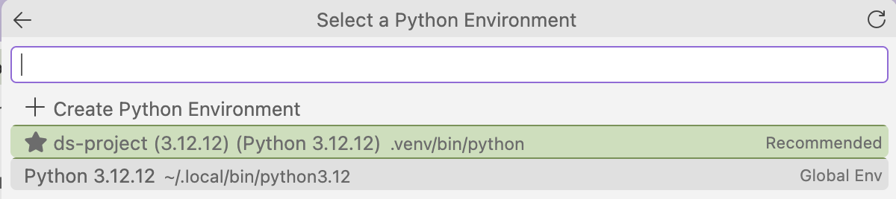

## Objetivo

En parejas, crearán un proyecto reproducible con **Git, GitHub, Python y `uv`**, y realizarán un análisis exploratorio de datos (EDA). Practicarán la creación de ramas, los **pull requests** y la documentación de sus decisiones. Al final, **todo el trabajo deberá estar integrado en `main`**.

::: {.callout-important}
Aunque trabajarán en archivos diferentes, **entregarán un solo análisis desarrollado en equipo**. La división en notebooks busca facilitar el uso de ramas y evitar conflictos de edición, **no dividir la tarea en dos trabajos aislados**.
:::


## Materiales de referencia

Antes de empezar, revisen los materiales que ya hemos trabajado:

- [Sesión técnica 02](../docs/st02.html): retomen los pasos para trabajar con Git, GitHub, Python y `uv`.
- [Curso propedéutico](https://github.com/ElenaVillano/prope-programacion): revisen los notebooks que están dentro de la carpeta de materiales
    - De manera opcional pueden clonar este repositorio y probar correr los notebooks en sus compus. 
- Dos notebooks de ejemplo de EDA y GEDA disponibles en la carpeta de notebooks del repo: copielos, ábranlos y ejecútenlos de principio a fin. Úsenlos como referencia para el código y procedimientos de análisis.


## 1. Crear el repositorio en parejas

1. Formen una pareja y elijan quién creará el repositorio.
2. En GitHub, abran el repositorio de referencia [`basic-template`](https://github.com/LDataLab/basic-template) y seleccionen **Use this template → Create a new repository**.
3. Denle un nombre descriptivo, por ejemplo `ds-project-team1`. Elijan la visibilidad que gusten y verifiquen que ambos puedan acceder.
4. La persona que lo creó debe invitar a su compañer@ y a mi usuario [ElenaVillano](https://github.com/ElenaVillano) en **Settings → Collaborators → Add people**.
5. Ambas personas deben clonar el mismo repositorio en sus computadoras (copien la URL SSH de **Code**):

```bash
git clone git@github.com:USUARIO/ds-project-team1.git
cd ds-project-team1
```

La estructura inicial que el repo tendrá es:

```markdown
.
├── data/
├── docs/
├── notebooks/
├── src/
├── .gitignore
├── pyproject.toml
└── README.md
```


## 2. Preparar las dependencias en `main` (trabajo conjunto)

Antes de crear sus ramas agreguen los paquetes que utilizarán. Una sola persona ejecutará estos comandos en `main`:

```bash
uv add pandas numpy matplotlib seaborn jupyter jupyter-cache
```

De manera automática, `uv add` actualiza el `pyproject.toml` y genera o actualiza `uv.lock`. Ambos archivos **sí deben subirse a GitHub** una vez
modificados. 

```bash
git status
git add pyproject.toml uv.lock
git commit -m "Configurar dependencias del proyecto"
git push origin main
```

La segunda persona actualiza su copia local **antes de crear su rama**:

```bash
git pull origin main
uv sync
```

::: {.callout-important}
## Acuerdos de colaboración

- Solo una persona modifica y sube las dependencias en `main` durante la configuración inicial.
- Después de la configuración inicial, **no se modifican archivos directamente en `main`**. Los cambios se integran mediante *pull requests*.
- Cada integrante trabaja en su propia rama y **modifica únicamente su notebook**. Eviten editar los mismos archivos (`README.md`, `pyproject.toml`, `uv.lock`, etc.) en ramas distintas.
- No suban `.venv/`, contraseñas ni credenciales. Revisen el archivo `.gitignore` que está diseñado para que no se rastreen los archivos y
carpetas de los portafolios especificados.
:::


### Cómo se organizarán como pareja

**Los dos integrantes son responsables de comprender toda la base de datos y los resultados del análisis.** Antes de dividir las actividades, exploren juntos una muestra de los registros, revisen el diccionario y acuerden:

- Qué representa cada fila, cuáles son las entidades y eventos principales y qué limitaciones conocen de los datos.
- Qué preguntas quieren responder y cómo se relacionan con el contexto del problema.
- Qué variables necesitan, cómo interpretarán sus categorías y qué transformaciones comunes realizarán.
- Cómo conectarán el notebook `01` con el notebook `02` para que la historia del análisis tenga continuidad.

Durante el desarrollo, **mantengan comunicación y revisen los avances de su pareja**. Quien haga las visualizaciones debe conocer las decisiones de calidad y limpieza; quien haga el perfilado debe conocer las preguntas y los resultados de las visualizaciones. Si uno descubre algo que cambia la interpretación del otro, deben discutirlo y ajustar ambos notebooks.

::: {.callout-important}
## Una sola historia, dos notebooks

El notebook `01` debe establecer el contexto, explicar qué información hay, evaluar su calidad y presentar los hallazgos iniciales. El notebook `02` debe **retomar explícitamente esos hallazgos** para formular preguntas, profundizar el análisis y presentar conclusiones. Eviten repetir innecesariamente secciones, usar definiciones contradictorias o entregar dos documentos que parezcan de proyectos distintos.

Los dos notebooks **deben poder ejecutarse de forma independiente**, sin depender de variables que solamente existan en la memoria del otro notebook. Esto no impide que el contenido y la narrativa sean consecutivos.
:::

:::{.callout-note}
## Ejecución de notebooks

Seleccionen como kernel el entorno Python del proyecto (`.venv`) creado por `uv`, usualmente Visual Studio
lo recomienda con una estrella:



Esto sucede porque ustedes previamente ya crearon un ambiente virtual.

:::


## 3. Crear una rama por integrante

Una vez que ambos tengan la versión actualizada de `main`, cada quien ejecutará en su computadora:

**Integrante A:**

```bash
git switch -c exploracion-estructura
```

**Integrante B:**

```bash
git switch -c exploracion-visualizaciones
```

Cada quien creará un notebook dentro de `notebooks/`:

- A: `nb01_estructura_perfilado.ipynb`
- B: `nb02_preguntas_visualizaciones.ipynb`


Para guardar avances:

```bash
git status
git add notebooks/
git commit -m "Avanzar en el analisis exploratorio"
git push -u origin NOMBRE_DE_TU_RAMA
```

Reemplacen `NOMBRE_DE_TU_RAMA` por el nombre que corresponde a cada integrante. La idea es que
realicen varios commits durante el desarrollo.

Al terminar su notebook, **abran un pull request para integrarlo a `main`**. Las instrucciones están en la sección 6. No es necesario aprender a resolver conflictos: precisamente por eso trabajarán en archivos diferentes.

## 4. Base de datos

Trabajaremos con datos de **incidentes viales reportados al C5 de la Ciudad de México**. Nos interesa explorar, entre otras preguntas, qué incidentes se confirman y cuáles se cierran con otros códigos.

Fuente: [Incidentes viales CDMX-C5](https://datos.cdmx.gob.mx/dataset/incidentes-viales-c5).

El conjunto registra información como folio, fechas y horas de creación y cierre, motivo del incidente, alcaldía, coordenadas, clasificación, origen y código de cierre. Consulten el diccionario de datos del portal para interpretar correctamente las variables.

Los códigos de cierre son:

| Código | Significado |
|---|---|
| A | Afirmativo: la unidad llegó y confirmó la emergencia. |
| N | Negativo: la unidad llegó, pero nadie confirmó la emergencia o solicitó apoyo. |
| I | Informativo: solicitud de información. |
| F | Falso: el incidente fue considerado falso en el lugar. |
| D | Duplicado: se registró el mismo incidente más de una vez. |

**Importante:** `N`, `F` y `D` no significan lo mismo. Para contar incidentes confirmados, utilicen `A`; para estudiar todos los reportes recibidos, consideren todos los códigos. No interpreten automáticamente todos los registros no afirmativos como falsas alarmas.

Pueden cargar una versión reducida:

```python
import pandas as pd

url = "https://raw.githubusercontent.com/ElenaVillano/databases/refs/heads/main/db_falsas_alarmas.csv"
df = pd.read_csv(url)
```

También pueden elegir una base de datos propia, siempre que tenga suficientes variables para explorar aspectos categóricos, numéricos o temporales y permita formular al menos cinco preguntas interesantes. En ese caso, documenten la fuente y el significado de las variables.

## 5. Distribución del análisis

Antes de trabajar en sus respectivos archivos, **ambas personas** deben revisar las columnas, acordar qué representa cada fila, cómo tratarán los valores faltantes y qué conversiones necesitan. Después dividirán la edición, **pero seguirán colaborando en las decisiones e interpretaciones**. No deben resolver cada sección sin consultar a la otra persona.

### Integrante A: estructura, entidades y perfilado

Entregar en `notebooks/nb01_estructura_perfilado.ipynb`:

#### 5.1. Contexto y estructura (2 puntos)

- ¿Qué fenómeno registra la base? ¿Quién la produjo y con qué propósito?
- ¿Cuántas filas y columnas tiene?
- ¿Qué significa cada variable? Descríbanla con sus propias palabras, apoyándose en el diccionario de datos.

#### 5.2. Entidades y eventos (2 puntos)

- ¿Cuál es la unidad de observación de cada fila?
- ¿Cuáles son las entidades relevantes y cómo se identifican?
- ¿Qué eventos aparecen y qué representan respecto de esas entidades?
- ¿Un folio identifica necesariamente un evento real distinto? Reflexionen sobre los duplicados.

#### 5.3. Tipos, calidad y limpieza (3 puntos)

- Identifiquen tipos de datos y valores faltantes.
- Revisen si las variables están representadas correctamente, especialmente fechas y horas.
- Hagan las conversiones necesarias y expliquen cada decisión.
- Identifiquen posibles duplicados, categorías inconsistentes o coordenadas fuera del rango esperado, cuando aplique.

#### 5.4. Data Profiling o perfilado por tipo de variable (3 puntos)

- **Categóricas:** categorías, frecuencias y valores faltantes.
- **Numéricas:** medidas descriptivas y valores extremos, si existen.
- **Temporales:** fechas mínima y máxima, cobertura y granularidad.
- Interpreten los resultados: no basta con imprimir tablas.

### Integrante B: preguntas y visualizaciones

Entregar en `notebooks/nb02_preguntas_visualizaciones.ipynb`:

#### 5.5. Preguntas de análisis (2 puntos)

Al inicio de este notebook, incluyan un breve párrafo que **conecte sus preguntas con lo encontrado en el notebook `01`**. Expliquen qué decisiones o hallazgos del perfilado son relevantes para las visualizaciones.

Formulen **al menos cinco preguntas** que puedan responder con los datos. Por ejemplo:

- ¿Qué proporción de reportes termina con cada código de cierre semanalmente?
- ¿Cómo cambia el número de reportes según el día de la semana?
- ¿Cuánto tiempo transcurre entre la creación y el cierre de los reportes?

Estas son sugerencias, formulen nuevas preguntas y que combinen información entre variables, (no solo hagan gráficos simples que describan una variable). Distingan entre el **número de reportes** y **tasas de prevalencia**.

::: {.callout-tip}
## ¿Qué queremos explorar?

No se limiten a generar gráficos de una sola variable. Intenten **combinar dos o más variables** para identificar relaciones, diferencias o patrones que no serían evidentes al analizarlas por separado.

Antes de construir cada gráfico, pregúntense: **¿Qué quiero descubrir y qué variables necesito relacionar para responderlo?**

No se trata de generar gráficos por cumplir, sino de formular preguntas interesantes sobre los datos, explorar posibles respuestas e interpretar sus hallazgos.
:::


#### 5.6. Visualizaciones e interpretación (5 puntos)

- Elaboren **mínimo cinco gráficos**, cada uno asociado a las preguntas del punto anterior.
- Elijan el tipo de gráfico adecuado, con títulos, ejes, unidades y leyendas cuando correspondan.
- Debajo de cada gráfico escriban una interpretación en una celda Markdown.
- Señalen al menos una limitación del análisis: cobertura temporal, valores faltantes, sesgos de registro o interpretación de códigos, por ejemplo.

No quiero gráficos solo por cumplir: cada visualización debe aportar información sobre las entidades, los eventos o sus características.

## 6. Integrar los cambios con pull requests

Cada integrante tendrá su propio notebook, por lo que podrán integrar sus aportaciones a `main` **sin modificar los mismos archivos**. Un *pull request* (PR) es una solicitud para revisar e incorporar cambios de una rama a otra.

### Paso 1. Subir la rama

Primero guarden los cambios de su notebook, hagan un commit y suban su rama a GitHub. Por ejemplo, para el integrante A:

```bash
git status
git add notebooks/01_estructura_perfilado.ipynb
git commit -m "Completar estructura y perfilado de datos"
git push -u origin exploracion-estructura
```

El integrante B hará lo mismo, pero con `notebooks/02_preguntas_visualizaciones.ipynb` y la rama `exploracion-visualizaciones`.

### Paso 2. Abrir un pull request en GitHub

1. Entren al repositorio de su pareja en GitHub.
2. Abran **Pull requests → New pull request** (o seleccionen **Compare & pull request** si aparece el aviso).
3. Verifiquen que **base: `main`** y **compare: su rama**.
4. Escriban un título descriptivo y una descripción breve: qué hicieron y qué debería revisar su pareja.
5. Seleccionen **Create pull request**.

::: {.callout-tip}
## ¿Qué deben revisar?

La otra persona debe abrir la pestaña **Files changed** del PR, comprobar que los cambios correspondan al notebook esperado y dejar un comentario de revisión. También puede revisar los resultados del notebook desde GitHub o ejecutarlo localmente.
:::

### Paso 3. Integrar a `main`

Una vez revisado el PR, seleccionen **Merge pull request → Confirm merge**. Si GitHub informa un conflicto, **no intenten resolverlo a ciegas**: revisen si ambas personas editaron algún archivo compartido y en caso afirmativo, me pueden escribir o lo vemos en clase.

Pueden integrar primero el PR de A y después el de B (o viceversa). Como cada persona modifica **un archivo diferente**, Git puede integrar ambos cambios sin conflictos.

### Paso 4. Actualizar su copia local

Después de integrar ambos PR, **las dos personas** ejecutan:

```bash
git switch main
git pull origin main
```

Revisen que `main` contenga **los dos notebooks** y que ambos puedan ejecutarse. No es necesario borrar las ramas.

## 7. Reproducibilidad y colaboración (3 puntos)

Se evaluará **tanto el uso de Git y GitHub como la colaboración en el análisis**. No basta con que cada quien suba su archivo: deben mostrar que ambos conocen el proyecto completo y que sus aportaciones se complementan. En particular:

- El repositorio tenga a ambos integrantes como colaboradores y conserve una estructura clara.
- `main` contenga `pyproject.toml` y `uv.lock` actualizados, sin subir `.venv/` ni credenciales.
- Cada integrante haya trabajado en su propia rama, hecho commits descriptivos y abierto un **pull request** para su notebook.
- Ambos PR estén **integrados en `main`**, y los dos notebooks sean ejecutables de principio a fin de manera independiente, con explicaciones en celdas Markdown.
- Los notebooks tengan **continuidad**: preguntas, conceptos, variables, criterios de limpieza e interpretaciones consistentes, sin contradicciones ni duplicación innecesaria.
- Cada integrante haya **revisado el trabajo de su pareja** y pueda explicar las decisiones principales y los resultados de ambos notebooks. Los comentarios de revisión en los PR son una forma de mostrar ese intercambio.

::: {.callout-note}
## Notebooks de trabajo o borradores

Pueden crear notebooks adicionales para probar código, explorar ideas o hacer análisis preliminares (aunque estén desordenados). **Pueden subirlos al repositorio**; no es necesario que todo el proceso de exploración quede limpio desde el primer intento. Lo importante es distinguir los archivos de trabajo de la entrega final.

En el `README.md`, **especifiquen claramente cuáles son los notebooks finales que quieren que revise** y en qué orden debo leerlos. Solo esos notebooks se considerarán como la entrega del análisis.
:::

## 8. Entrega

Entreguen **un solo enlace por pareja** al repositorio de GitHub en Canvas

Finalmente en `main`, actualicen el `README.md` para incluir:

- Nombre del proyecto e integrantes.
- Fuente de los datos y objetivo del análisis.
- Instrucciones para reproducir el entorno: `uv sync`.
- Qué realiza cada integrante y cómo se conectan ambas partes del análisis.
- **La lista de notebooks finales que debo revisar, en el orden de lectura**, diferenciándolos de los notebooks de pruebas o borradores que hayan subido.

Al terminar, revisen en GitHub que **`main` contenga los dos notebooks** y los archivos de dependencias. En la pestaña **Pull requests**, ambos PR deben aparecer como **Merged** y que ambos tengan los mismos cambios del repositorio remoto en su repositorio local. 

## 9. Criterios de evaluación

| Criterio | Puntos |
|---|---:|
| Contexto y estructura de los datos | 2 |
| Entidades y eventos | 2 |
| Tipos, calidad y limpieza | 3 |
| Perfilado de variables | 3 |
| Preguntas de análisis | 2 |
| Visualizaciones e interpretación | 5 |
| Reproducibilidad y colaboración | 3 |
| **Total** | **20** |

La calificación considera el trabajo conjunto y las contribuciones de cada integrante. Las interpretaciones deben ser propias y estar respaldadas por los resultados observados.

Escríbanme si tienen dudas.

¡Suerte!

E.
